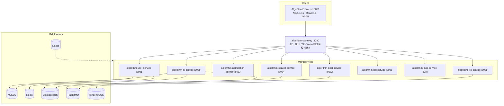

# 衍序 · AlgoFlow 后端微服务集群 (AlgoFlow Backend)

<p align="center">
  <strong>推衍秩序 · 步进数据心流 | 面向排序算法教学的 RAG 增强型交互式系统 · 微服务后端</strong>
</p>

<p align="center">
  <a href="https://github.com/StephenQiu30/algoflow/actions"></a>
  <a href="../LICENSE"></a>
  <a href="https://github.com/StephenQiu30/algoflow/stargazers"></a>
  
  
  
  
</p>

> **English**: Open-source RAG backend for interactive sorting-algorithm teaching — Spring Boot 3.5+ / Spring Cloud 2025 / Spring Cloud Alibaba / Spring AI / Elasticsearch hybrid retrieval / SSE streaming answers.
>
> **中文**：完整可运行的 Spring Cloud Alibaba + Spring AI 工程骨架，覆盖统一路由网关、用户认证、讨论社区、知识库切片、混合多路检索、流式解惑与运营审计。

---

## 核心架构拓扑



### RAG 核心流水线

```text
算法教学文档 (Markdown/PDF/Word)
    ↓
文档解析与文本清洗
    ↓
语义切片、重叠窗口与元数据注入
    ↓
MySQL 持久化 + Elasticsearch 向量索引
    ↓
向量余弦召回 + BM25 关键词召回
    ↓
RRF（Reciprocal Rank Fusion）多路重排
    ↓
Spring AI 上下文组装 → SSE 流式回答
```

---

## 微服务集群矩阵

| 微服务模块 | 端口 | 核心职责 |
| :--- | :--- | :--- |
| `algorithm-gateway` | 8080 | 统一 API 网关、路由转发、Sa-Token 鉴权、Redis 限流、请求上下文注入 |
| `algorithm-user-service` | 8081 | 账号注册登录、GitHub OAuth2、权限控制、个人资料中心 |
| `algorithm-post-service` | 8082 | 学习题解与讨论区、评论互动、点赞收藏、内容审核 |
| `algorithm-notification-service`| 8083 | 站内通知、未读计数、多端实时触达 |
| `algorithm-search-service` | 8084 | Elasticsearch 9.3+ 全文检索、聚合与增量同步 |
| `algorithm-file-service` | 8085 | 上传校验、腾讯云 COS / 本地临时存储下发 |
| `algorithm-log-service` | 8086 | 操作审计日志、系统登录日志、API 访问轨迹异步落库 |
| `algorithm-mail-service` | 8087 | 邮箱验证码发送、异常报警与系统邮件 |
| `algorithm-ai-service` | 8088 | 知识库治理、文档切片向量化、通义千问大模型流式问答 |

---

## 技术选型栈

- **语言与核心框架**：Java 21 (LTS) / Spring Boot 3.5+ / Spring Cloud 2025 / Spring Cloud Alibaba 2023
- **微服务治理**：Spring Cloud Gateway + Nacos (服务发现与动态配置) + OpenFeign
- **鉴权与安全**：Sa-Token 1.44+ (网关统一鉴权 + Redis Session 共享 + JWT)
- **数据库与缓存**：MySQL 8.0+ / MyBatis-Plus 3.5+ / Redis 7.0+ / Redisson 3.48+ / Caffeine 3.2+
- **消息与队列**：RabbitMQ 3.13+ (Spring Boot AMQP)
- **AI 与全文检索**：Spring AI Alibaba 1.1+ (通义千问 Qwen) / Elasticsearch 9.3+
- **长连接与文件**：Spring WebSocket / Netty / 腾讯云 COS / EasyExcel / Flexmark

---

## 快速上手与运行

### 1. 基础环境
- JDK 21、Maven 3.9+
- Docker 与 Docker Compose
- MySQL 8.0+、Redis 7.0+、RabbitMQ 3.13+、Nacos 2023+、Elasticsearch 9.3+

### 2. 数据库与 Nacos 初始化
```bash
# 初始化 MySQL 数据库
mysql -u root -p < sql/algorithm.sql

# 导入 Nacos 配置中心
cd nacos-config
chmod +x import-config.sh
./import-config.sh
```

### 3. 构建与本地运行
```bash
cd backend

# 编译并安装全部公共模块与微服务
mvn clean install -DskipTests

# 本地启动特定微服务 (以 Gateway 与 User 服务为例)
mvn -pl algorithm-gateway spring-boot:run
mvn -pl algorithm-service/algorithm-user-service spring-boot:run
```

---

## 项目体系联动

本项目为 **衍序 · AlgoFlow** 统一 Monorepo 体系的微服务后端：
- 完整项目仓库：[StephenQiu30/algoflow](https://github.com/StephenQiu30/algoflow)
- 前端交互系统位于根目录下的 [`frontend/`](../frontend/)。
