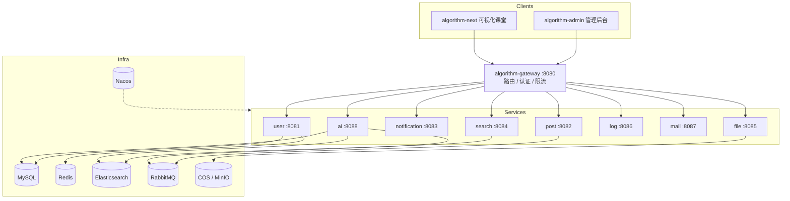

# Algorithm Cloud · RAG-Enhanced Sorting Algorithm Teaching Platform

<p align="center">
  <strong>面向排序算法教学的 RAG 增强型交互式系统 · Spring Cloud Alibaba 微服务后端</strong>
</p>

<p align="center">
  <a href="https://github.com/StephenQiu30/algorithm-cloud/actions/workflows/maven.yml"></a>
  <a href="LICENSE"></a>
  <a href="https://github.com/StephenQiu30/algorithm-cloud/stargazers"></a>
  
  
  
</p>

> **English**: Open-source RAG backend for interactive sorting-algorithm teaching — Spring Boot 3 / Spring Cloud Alibaba / Spring AI / Elasticsearch hybrid retrieval / SSE streaming answers.
>
> **中文**：完整可运行的 Spring Cloud Alibaba + Spring AI 工程骨架，覆盖用户认证、内容社区、知识库、混合检索、流式问答与运营审计。

如果你在找 **Spring AI RAG 示例**、**Spring Cloud Alibaba 微服务实战**、**Elasticsearch 向量 + BM25 混合检索**，或**排序算法教学平台后端**，这个仓库可以直接作为学习与二次开发的起点。

---

## Why this project

| 你想解决的问题 | 本仓库提供什么 |
|----------------|----------------|
| 想落地一套 RAG，但缺完整工程链路 | 文档解析 → 切片 → 向量入库 → 混合召回 → SSE 流式回答 |
| 想学微服务治理，但缺业务上下文 | 网关 / Nacos / 认证 / 限流 / 异步任务 / 审计日志一体 |
| 想做算法教学产品，缺后端 | 用户、帖子、评论、知识库、搜索、通知、文件、邮件全开箱 |

---

## Architecture



### RAG 核心链路

```text
教学文档上传
    ↓
解析与文本清洗（Markdown / PDF / Word）
    ↓
段落合并、语义切片、重叠窗口
    ↓
MySQL 持久化 + Elasticsearch 向量索引
    ↓
向量召回 + BM25 关键词召回
    ↓
RRF（Reciprocal Rank Fusion）融合排序
    ↓
Spring AI 组织上下文 → SSE 流式回答
```

---

## Features

- **RAG 智能问答**：多格式教学材料入库，支持 SSE 流式回答
- **混合检索**：ES 向量 + BM25，并行召回后 RRF 融合
- **知识库运营**：知识库 / 文档 / 分片 / 召回分析 / 检索追踪
- **内容社区**：用户、帖子、评论、点赞、收藏、审核、摘要
- **微服务治理**：Nacos、Gateway、Sa-Token、Redis 限流、统一异常
- **异步链路**：RabbitMQ 解耦文档入库、AI 摘要、搜索同步、通知
- **可观测审计**：业务操作 / 登录 / API 访问日志；可选 Prometheus + Grafana
- **对象存储**：腾讯云 COS 与开发环境 MinIO

---

## Microservices

| 模块 | 职责 | 端口 |
| --- | --- | ---: |
| `algorithm-gateway` | API 网关、路由、认证、限流、链路日志 | 8080 |
| `algorithm-user-service` | 邮箱/GitHub 登录、资料、角色权限 | 8081 |
| `algorithm-post-service` | 帖子、评论、点赞、收藏、审核 | 8082 |
| `algorithm-notification-service` | 站内通知、未读数、实时触达 | 8083 |
| `algorithm-search-service` | ES 全文检索、聚合、索引同步 | 8084 |
| `algorithm-file-service` | 上传校验、COS/MinIO | 8085 |
| `algorithm-log-service` | 审计与访问日志 | 8086 |
| `algorithm-mail-service` | 验证码与异步邮件 | 8087 |
| `algorithm-ai-service` | 知识库、文档处理、RAG 问答 | 8088 |

更多模块说明见 [algorithm-api](algorithm-api/)、[algorithm-common](algorithm-common/)、[algorithm-gateway](algorithm-gateway/README.md)、[algorithm-service](algorithm-service/)。

---

## Tech Stack

| 领域 | 技术 |
| --- | --- |
| 运行时 | Java 21、Maven |
| 微服务 | Spring Boot 3.x、Spring Cloud、Spring Cloud Alibaba、Gateway |
| AI / RAG | Spring AI、DashScope、ES Vector Store |
| 数据 | MySQL、MyBatis-Plus、Redis、Redisson、Caffeine |
| 消息 / 实时 | RabbitMQ、WebSocket |
| 治理 | Nacos、Sa-Token、OpenFeign、Knife4j |
| 观测 | Elasticsearch、Logstash、Prometheus、Grafana |

---

## Quick Start

### 1. 环境

- JDK 21、Maven 3.9+
- Docker 与 Docker Compose
- 使用 AI 服务时准备 DashScope / LLM 配置

### 2. 启动基础设施

```bash
cp .env.example .env
# 按 docker-compose-env.yml 填写 MySQL / Redis / Nacos / RabbitMQ 等变量
docker compose -f docker-compose-env.yml up -d
```

Nacos：<http://localhost:8848/nacos>　|　RabbitMQ：<http://localhost:15672>

### 3. 初始化数据库与配置

```bash
mysql -u root -p < sql/algorithm.sql

cp nacos-config/common-secret.properties.example \
   nacos-config/common-secret.properties
# 填写数据库、Redis、对象存储、AI API
chmod +x nacos-config/import-config.sh
./nacos-config/import-config.sh
```

### 4. 构建并启动服务

```bash
mvn clean install -DskipTests
docker compose up -d --build
```

也可在 IDE 中直接启动各 `*Application`。完整说明见 [nacos-config/README.md](nacos-config/README.md)。

---

## Who is this for

- 想系统学习 **Spring Cloud Alibaba + Spring AI** 的 Java 开发者
- 需要 **RAG 检索增强** 完整参考实现的工程师
- 做 **算法可视化 / 在线教育** 产品，需要可扩展后端的团队
- 课程设计、毕业设计、教学演示需要「能跑通的微服务 + AI」骨架

---

## Learning Docs

仓库内置排序算法教学文档（可直接导入知识库）：

- [学习路径与知识图谱](docs/18-排序算法学习路径与知识图谱.md)
- [排序算法综合对比](docs/09-排序算法综合对比.md)
- [工程实践](docs/10-排序算法的工程实践.md)
- [面试高频问题](docs/12-排序算法的面试高频问题.md)
- [全部算法文档](docs/)

---

## Related Repositories

| 仓库 | 角色 |
| --- | --- |
| [algorithm-next](https://github.com/StephenQiu30/algorithm-next) | 排序可视化课堂 + RAG 问答（用户端） |
| [algorithm-admin](https://github.com/StephenQiu30/algorithm-admin) | 管理后台（用户 / 内容 / 知识库运营） |
| **algorithm-cloud（本仓库）** | 微服务后端与 RAG 核心 |

---

## Contributing

欢迎 Issue 与 PR。请先阅读 [CONTRIBUTING.md](CONTRIBUTING.md)。

```bash
mvn clean install          # 编译全部模块
mvn clean install -DskipTests
```

提交前请同步更新受影响模块的 README、配置示例与 API 文档，勿提交本地凭证。

---

## Star History

[](https://star-history.com/#StephenQiu30/algorithm-cloud&Date)

如果这个项目对你有帮助，欢迎点个 **Star**——这会帮助更多开发者发现它。

---

## License

[Apache License 2.0](LICENSE)

## Maintainer

[StephenQiu30](https://github.com/StephenQiu30)
