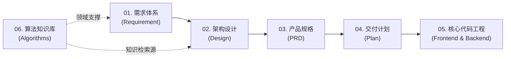

# 衍序 · AlgoFlow 文档中心

> **推衍秩序 · 步进数据心流**  
> 衍序 (AlgoFlow) 统一工程与研发文档中心，遵循标准化软件工程生命周期：  
> **需求定义 (Requirement) → 系统设计 (Design) → 产品规划 (PRD) → 交付计划 (Plan) → 领域知识库 (Algorithms)**。

---

## 🧭 全流程研发体系架构

AlgoFlow 采用全链路可追溯的工程文档架构。每一项功能演进均严格遵循从业务需求到技术设计、产品原型、开发计划与最终代码实现的端到端闭环：

---

## 📂 文档中心目录索引

| 阶段 / 模块 | 核心定位与说明 | 主要文档索引 |
| :--- | :--- | :--- |
| **00. Templates** | 标准工程写作模板库，约束技术设计、用户故事、PRD、实施计划与测试场景输出格式 | <ul><li>[00-模板导航](./templates/00-模板导航.md)</li><li>[01-设计模板](./templates/01-设计模板.md)</li><li>[02-用户故事模板](./templates/02-用户故事模板.md)</li><li>[03-测试场景模板](./templates/03-测试场景模板.md)</li><li>[04-PRD模板](./templates/04-PRD模板.md)</li><li>[05-实施计划模板](./templates/05-实施计划模板.md)</li></ul> |
| **01. Requirement** | 业务背景、用户画像、核心痛点与系统需求规格说明书 (SRS/URS) | <ul><li>[00-需求导航](./requirement/00-需求导航.md)</li><li>[01-产品总览与系统需求规格说明](./requirement/01-产品总览与系统需求规格说明.md)</li><li>[02-敏捷用户故事与验收准则](./requirement/02-敏捷用户故事与验收准则.md)</li></ul> |
| **02. Design** | 微服务架构、Apple 极简设计系统、数据持久化与 RAG 向量引擎技术方案 | <ul><li>[00-设计导航](./design/00-设计导航.md)</li><li>[01-平台顶层微服务架构设计](./design/01-平台顶层微服务架构设计.md)</li><li>[02-Apple极简视觉与高帧率动效设计](./design/02-Apple极简视觉与高帧率动效设计.md)</li><li>[03-数据模型持久化与缓存架构设计](./design/03-数据模型持久化与缓存架构设计.md)</li><li>[04-RAG算法导师与知识检索设计](./design/04-RAG算法导师与知识检索设计.md)</li><li>[05-shadcn顶部布局与全站交互规范](./design/05-shadcn顶部布局与全站交互规范.md)</li></ul> |
| **03. PRD** | 产品需求说明书、信息架构 (IA)、交互原型流程与各核心功能模块详设 | <ul><li>[00-PRD导航](./prd/00-PRD导航.md)</li><li>[01-产品全景与信息架构PRD](./prd/01-产品全景与信息架构PRD.md)</li><li>[02-算法动态演练工作台PRD](./prd/02-算法动态演练工作台PRD.md)</li><li>[03-RAG增强型AI算法导师PRD](./prd/03-RAG增强型AI算法导师PRD.md)</li><li>[04-社区讨论与题解博客PRD](./prd/04-社区讨论与题解博客PRD.md)</li><li>[05-统一运营与知识库切片管理后台PRD](./prd/05-统一运营与知识库切片管理后台PRD.md)</li></ul> |
| **04. Plan** | 迭代里程碑、排期路线图 (Roadmap)、测试策略与上线发布方案 | <ul><li>[00-Plan导航](./plan/00-Plan导航.md)</li><li>[01-研发里程碑与工程路线图](./plan/01-研发里程碑与工程路线图.md)</li><li>[02-核心算法演练引擎实施计划](./plan/02-核心算法演练引擎实施计划.md)</li><li>[03-RAG导师与演练快照联动实施计划](./plan/03-RAG导师与演练快照联动实施计划.md)</li><li>[04-测试策略与发布交付方案](./plan/04-测试策略与发布交付方案.md)</li></ul> |
| **05. Algorithms** | 19 篇经典与现代排序算法深度解构、教学动画设计与应用场景知识库 | <ul><li>[00-知识库总览与编写规范](./algorithms/README.md)</li><li>[18-学习路径与知识图谱](./algorithms/18-排序算法学习路径与知识图谱.md)</li><li>[01~17 经典算法专章](./algorithms/)</li></ul> |

---

## 📌 根目录状态协同文件

为确保多人协作与多 Agent 协同的高效连续性，项目根目录维护两份动态跟踪看板：

1. **[BACKLOG.md](../BACKLOG.md)**：项目任务积压池与实时执行状态看板（按 Epic 划分，清晰标注优先级、责任模块与交付进展）。
2. **[HANDOVER.md](../HANDOVER.md)**：开发接力与工作交接单（包含当前编译运行快照、待解决阻断点、开发指引及下一步行动方案）。

---

## 📐 工程协同规范与守则

* **架构分层与研发守则**：详见根目录 [PROJECT.md](../PROJECT.md)。
* **多 Agent 研发与代码规范**：详见根目录 [AGENTS.md](../AGENTS.md)。
* **代码贡献流程**：详见根目录 [CONTRIBUTING.md](../CONTRIBUTING.md)。
