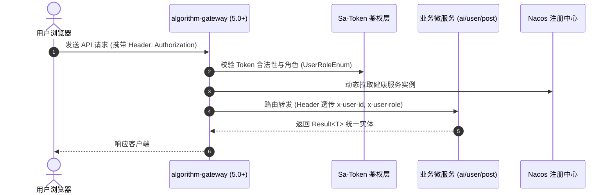

# 平台顶层微服务架构设计

> **文档编号**：DES-01  
> **状态**：已确认。依据：[需求01 §3 & §5](../requirement/01-产品总览与系统需求规格说明.md)，工程规范见 [PROJECT.md](../../PROJECT.md)；已确认、建议与待定分别标注。不要复制 BACKLOG 的进度表。

---

## 1. 摘要

AlgoFlow 采用统一 Monorepo 架构，包含前端 Next.js 15 App Router 全栈、基于 Java 21 + Spring Boot 3.5 + Spring Cloud Alibaba 2023 构建的高可用微服务集群、统一鉴权网关与异步解耦中枢。本设计定义微服务边界、统一通信契约、网关路由鉴权以及全局异常包装规范。

---

## 2. 参与者与职责

* **业务与教研确认人**：教研负责人（确认教学交互与知识切片边界）；
* **架构评审人**：后端技术负责人、前端架构负责人；
* **技术实施责任**：后端微服务团队、前端交互团队。

---

## 3. 背景与约束

* **系统现状**：后端拆分为 30 个 Maven 模块（含 common 通用基础、api 契约声明、service 业务实现及 gateway 网关）；前端为统一 Next.js 15 单一工程；
* **规范约束**：严格遵循《阿里巴巴 Java 开发手册》；严禁新建独立的前端 Admin 工程，管理端统一内置于 `frontend/src/app/admin/`；
* **通信约束**：微服务间绝对隔离，只通过 `algorithm-api/*` 声明的 OpenFeign 客户端接口进行契约通信。

---

## 4. 目标与非目标

### 4.1 核心目标
1. 建立基于 `algorithm-gateway` 的集中鉴权与动态路由，配合 Sa-Token 网关拦截器实现无状态 JWT 传递；
2. 规范微服务调用强契约，杜绝循环依赖与跨库写操作；
3. 全局统一返回实体 `Result<T>` 与全局异常捕获，保障前后端交互协议健壮性；
4. 保证网关与各微服务可水平伸缩，单点宕机不波及全站。

### 4.2 非目标
* 本期不引入复杂的分布式事务两阶段提交框架（Seata），跨服务弱一致性依靠 RabbitMQ 可靠消息最终一致性保障。

---

## 5. 使用场景与链路



---

## 6. 核心价值

* **架构解耦**：彻底解决传统单体架构下算法演算高频请求拖垮核心持久库的风险；
* **研发效率**：`algorithm-api/*` 明确各服务对外接口声明，前后端与服务间实现并行研发；
* **高可用与安全**：网关前置鉴权与限流，保护内部微服务不受外部恶意流量直接冲击。

---

## 7. 方案详述

### 7.1 服务与数据所有权划分 [已确认]

| 服务模块 | 唯一职责 | 严禁行为 | 对应 API 契约包 |
| :--- | :--- | :--- | :--- |
| **`algorithm-gateway`** | 统一动态路由、Sa-Token 网关鉴权、跨域与全局限流 | 严禁编写业务数据库读写逻辑 | 独立应用 |
| **`algorithm-ai-service`** | 向量嵌入、知识切片检索、Prompt 编排与大模型 SSE 流式输出 | 严禁直接修改用户账户与角色数据 | `algorithm-api-ai` |
| **`algorithm-user-service`** | 账号注册、登录认证、个人资料、角色与权限维护 | 严禁直接存储大模型生成的切片向量 | `algorithm-api-user` |
| **`algorithm-post-service`** | 社区算法题解发布、评论、点赞与学习打卡记录 | 严禁搬运媒体二进制文件 | `algorithm-api-post` |
| **`algorithm-search-service`**| 基于 ES 的全站算法知识与题解混合检索 | 严禁作为第一权威持久源（权威在 MySQL） | `algorithm-api-search` |
| **`algorithm-file-service`** | 腾讯云 COS / 对象存储预签名凭证分发与元数据记录 | 严禁内存中搬运大文件字节流 | `algorithm-api-file` |

### 7.2 统一响应与异常拦截 [已确认]
所有微服务 Controller 统一返回 `Result<T>`：
```java
public class Result<T> implements Serializable {
    private Integer code;    // 0: 成功, 其他: 业务错误码
    private T data;          // 业务载荷
    private String message;   // 状态说明
    private Long timestamp;  // 时间戳
}
```
`algorithm-common-web` 提供全局 `@RestControllerAdvice` 统一捕获 `BusinessException` 与未检异常，杜绝裸露 SQL 报错。

### 7.3 来源追踪与用户故事映射 [已确认]
* 支撑用户故事 [US-101 算法单步与多速演示控制](../requirement/02-敏捷用户故事与验收准则.md#故事-101-算法单步与多速演示控制)；
* 支撑用户故事 [US-201 演练工作台步骤快照感知答疑](../requirement/02-敏捷用户故事与验收准则.md#故事-201-演练工作台当前步骤快照感知答疑)。

---

## 8. 实施与验收核对

* **实施依赖**：JDK 21、Nacos 2023+、MySQL 8.0+、Redis 7.0+；
* **正常场景验收**：通过网关请求 `/api/user/info`，成功透传用户上下文并返回封装 `Result<UserVO>`；
* **异常场景验收**：非法 Token 拦截并返回 401；内部抛出业务异常返回对应错误码；
* **真实执行证据**：后端 30 个微服务子模块 `mvn test-compile -DskipTests` 全量 SUCCESS（详见 [HANDOVER.md](../../HANDOVER.md)）；实施调度引用 [BACKLOG.md](../../BACKLOG.md) `TSK-103`、`TSK-104`。
