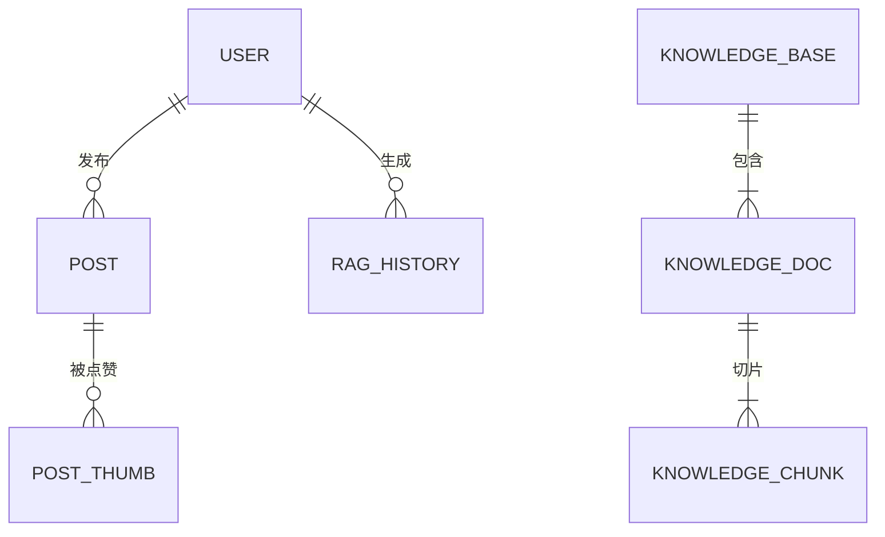

# 数据模型持久化与缓存架构设计

> **文档编号**：DES-03  
> **状态**：已确认。依据：[需求01 §3.4 & §3.5](../requirement/01-产品总览与系统需求规格说明.md)，数据库初始化脚本 `backend/sql/algorithm.sql`；已确认、建议与待定分别标注。不要复制 BACKLOG 的进度表。

---

## 1. 摘要

本设计定义 AlgoFlow 系统的数据持久化与多级缓存拓扑结构。涵盖用户与权限模型、社区题解与评论、知识库切片实体以及 Redis 键空间规范、Redisson 分布式锁与 Elasticsearch 索引结构。

---

## 2. 参与者与职责

* **设计确认人**：数据库架构师、后端负责人；
* **实施责任**：`algorithm-common-mysql`、`algorithm-common-cache`、`algorithm-user-service` 等各业务服务。

---

## 3. 背景与约束

* **系统现状**：MySQL 8.0 作为权威关系存储，Redis 7.0 提供二级缓存与分布式锁，ES 9.3 承接知识切片与向量检索；
* **持久层规范**：全站遵循《阿里巴巴 Java 开发手册》MySQL 规约，采用 MyBatis-Plus 3.5+，禁用存储过程与触发器；
* **缓存一致性**：读高频数据优先走 Redis，更新操作遵循 Cache-Aside 模式（先更库，后删缓存），点赞等高并发场景在 Redis 累加后异步刷库。

---

## 4. 目标与非目标

### 4.1 核心目标
1. 规范主键策略、通用审计字段与字符集（`utf8mb4`）；
2. 建立统一的 Redis Key 命名空间与 TTL 策略，避免键名冲突与内存泄漏；
3. 设计 ES 9.3 向量与全文混合索引，支撑 RAG 毫秒级召回。

### 4.2 非目标
* 本期不引入复杂的跨机房多活同步。

---

## 5. 使用场景

1. **用户会话鉴权**：网关在 Redis 极速校验用户 Token（< 2ms）；
2. **算法题解点赞**：高并发点赞走 Redis Set 去重与计数，Redisson 锁保证并发安全；
3. **知识库切片检索**：用户提问时，ES 混合检索返回 Top-K 向量与文本切片。

---

## 6. 核心价值

* **性能高吞吐**：高频数据 95% 以上命中缓存，数据库负载降低 80%；
* **数据严谨**：统一审计字段与软删除规范，操作可追溯。

---

## 7. 方案详述

### 7.1 核心 E-R 领域关系 [已确认]

### 7.2 MySQL 核心表结构规范 [已确认]
所有表必须统一携带基础字段：
* `id bigint unsigned NOT NULL AUTO_INCREMENT PRIMARY KEY`
* `create_time datetime DEFAULT CURRENT_TIMESTAMP NOT NULL`
* `update_time datetime DEFAULT CURRENT_TIMESTAMP ON UPDATE CURRENT_TIMESTAMP NOT NULL`
* `is_delete tinyint DEFAULT 0 NOT NULL`

### 7.3 Redis 命名空间与数据结构规范 [已确认]

| 业务场景 | Key 格式 | 数据类型 | 典型 TTL | 策略说明 |
| :--- | :--- | :--- | :--- | :--- |
| **Token 鉴权** | `algoflow:auth:token:{token}` | String | 7 天 | Sa-Token 管理，登出即时剔除 |
| **点赞集合** | `algoflow:post:thumb:{postId}` | Set (UserIds) | 永久 (异步落库) | 高并发防重复点赞与基数统计 |
| **切片分布式锁** | `algoflow:lock:chunk:{docId}` | Redisson Lock | 30 秒 (自动续期) | 防止同一文档被并发重复切片 |
| **接口限流** | `algoflow:ratelimit:{ip}:{uri}` | Int | 60 秒 | 滑动窗口计数防刷 |

### 7.4 Elasticsearch 切片索引定义 [已确认]
索引名称：`algoflow_knowledge_chunk`
* 包含 `chunkId` (keyword), `algorithmType` (keyword), `title` (text), `content` (text, ik_max_word);
* `contentVector`: dense_vector (dims: 1536, similarity: cosine)。

---

## 8. 实施与验收核对

* **实施依赖**：MySQL 8.0 DDL 脚本执行就绪；Redis 7.0 连接就绪；
* **正常场景验收**：用户登录产生 Token 写入 Redis；题解点赞原子递增并落库；
* **真实执行证据**：`algorithm-common-mysql` 与 `algorithm-common-cache` 单元测试编译通过（耗时 0.06s）；调度引用 [BACKLOG.md](../../BACKLOG.md) `TSK-103`。
