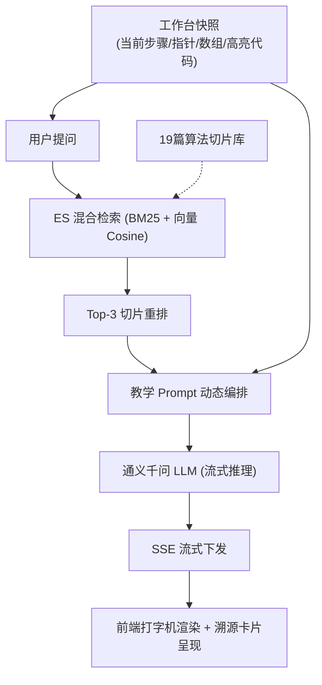

# RAG 算法导师与知识检索设计

> **文档编号**：DES-04  
> **状态**：已确认。依据：[需求01 §3.2](../requirement/01-产品总览与系统需求规格说明.md)，[用户故事 US-201](../requirement/02-敏捷用户故事与验收准则.md#故事-201-演练工作台当前步骤快照感知答疑)；已确认、建议与待定分别标注。不要复制 BACKLOG 的进度表。

---

## 1. 摘要

为解决通用大模型在复杂算法推演中的“幻觉问题”与“缺乏当前步骤上下文”的问题，本设计提出面向排序算法教学的专属 RAG 增强型导师架构。采用离线 Flexmark AST 语义分块、在线演练工作台步骤快照感知、Elasticsearch 9.3 混合检索加权重排与 Server-Sent Events (SSE) 流式推演。

---

## 2. 参与者与职责

* **确认人**：教研负责人（审定 19 篇算法知识库切片质量与 Prompt 模板）；
* **架构评审**：AI 算法工程师、后端负责人；
* **实施责任**：`algorithm-ai-service`、前端 RAG 对话团队。

---

## 3. 背景与约束

* **系统现状**：后端基于 Spring AI Alibaba 1.1+ 对接通义千问（Qwen-Max/Plus）；前端提供抽屉式交互面板 `RAGChatPanel.tsx`；
* **防幻觉红线**：大模型回答必须严格基于官方教研切片，禁止臆造未经推导的算法渐进界；
* **性能约束**：端到端首字响应时间 (TTFB) ≤ 1200ms。

---

## 4. 目标与非目标

### 4.1 核心目标
1. 实现演练工作台指针与数组快照自动注入 Prompt；
2. 离线 Markdown 文档按标题层级（H1/H2/H3）智能切片，单块 400~800 Token，100 Token 重叠；
3. 检索结果包含权威来源引用，支持溯源跳转；
4. 保证 SSE 连接在网络抖动时支持客户端主动重试与取消（Abort）。

### 4.2 非目标
* 本期不进行端到端全参数微调（Fine-Tuning），完全依托 RAG 检索增强。

---

## 5. 使用场景与全链路

---

## 6. 核心价值

* **答疑精准度**：AI 导师不再回答“泛泛而谈的定义”，而是精准指出“第 12 步为什么 15 与 42 发生了交换”；
* **教学闭环**：回答与教研切片深度关联，杜绝误人子弟的幻觉。

---

## 7. 方案详述

### 7.1 算法切片规则 (Chunking Strategy) [已确认]
* **语法树分割**：基于 Flexmark 解析 Markdown 标题 AST，每个切片前缀保留前置父标题链（如 `快速排序 > 双指针分区策略 > 三数取中`）；
* **分块窗口**：单切片控制在 400~800 tokens，滑窗重叠 100 tokens；
* **元数据标引**：附带 `algorithmType`, `docTitle`, `sectionTitle`, `tokenSize` 等元数据。

### 7.2 混合检索与重排算法 [已确认]
综合打分公式：
$$\text{Score} = 0.3 \times \text{Score}_{\text{BM25}} + 0.7 \times \text{Score}_{\text{Cosine}}$$
截取 Top-3 相关度切片拼装入 System Prompt。

### 7.3 SSE 流式通信协议 [已确认]
* 路径：`POST /api/ai/rag/chat/stream`
* 事件帧：
  - `event: message`: 携带正文字符增量 `delta`；
  - `event: source`: 携带检索切片来源（标题、章节、分值）；
  - `event: done`: 标记流式结束。

### 7.4 用户故事映射 [已确认]
* 支撑用户故事 [US-201 演练工作台步骤快照感知答疑](../requirement/02-敏捷用户故事与验收准则.md#故事-201-演练工作台当前步骤快照感知答疑)；
* 支撑用户故事 [US-401 知识库 Markdown 自动化切片与向量化](../requirement/02-敏捷用户故事与验收准则.md#故事-401-知识库-markdown-自动化切片与向量化)。

---

## 8. 实施与验收核对

* **实施依赖**：Elasticsearch 9.3 向量检索模块、通义千问 API 凭证；
* **正常场景验收**：提问“当前步骤做了什么？”，返回针对性解释与对应切片来源；
* **真实执行证据**：前端 `SSE supports split UTF-8, all delimiters, multiline fields and ignores comments` 单元测试通过；实施调度引用 [BACKLOG.md](../../BACKLOG.md) `TSK-107`、`TSK-201`。
