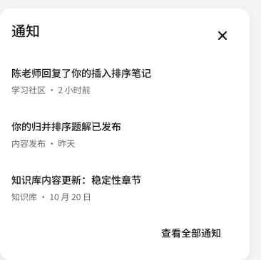
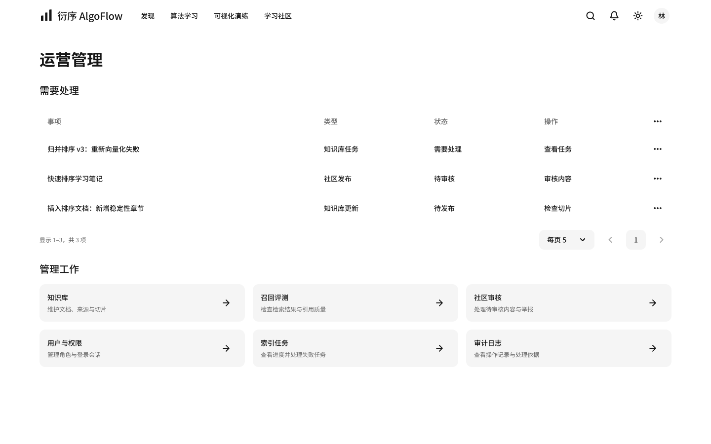
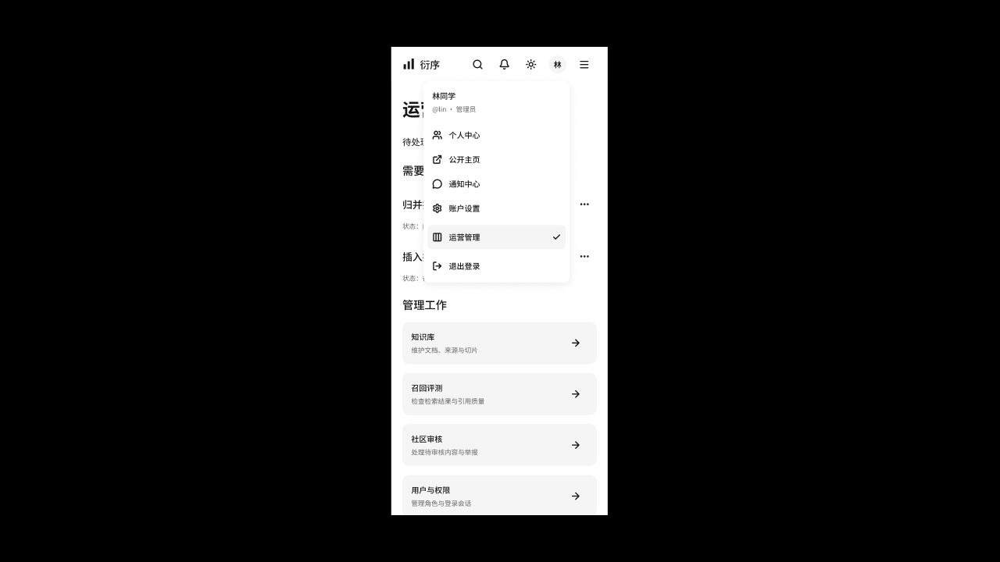

# Figma 当前设计与验收

> DES-06 · 更新：2026-10-23。仅维护当前结果，不累积阶段快照。本文记录 Figma 基线与原型验收；前端已按此基线进入实现，范围和运行证据分别见 [前端实施计划](../plan/05-全站前端页面实现计划.md) 与 [HANDOVER](../../HANDOVER.md)。

## 设计入口

唯一文件为 [AlgoFlow 教学与运营设计系统](https://www.figma.com/design/cMWO5SCKWFqJafxME0yhFz?node-id=74-31)，唯一页面为「AlgoFlow · 当前设计」（74:31）。只保留当前页面、必要的响应式/状态变体、组件和一块基础说明板。

| 场景 | 桌面 | 平板 | 手机 |
| --- | --- | --- | --- |
| 发现 | [查看](https://www.figma.com/design/cMWO5SCKWFqJafxME0yhFz?node-id=77-31) | [查看](https://www.figma.com/design/cMWO5SCKWFqJafxME0yhFz?node-id=217-14556) | [查看](https://www.figma.com/design/cMWO5SCKWFqJafxME0yhFz?node-id=80-318) |
| 算法目录 | [查看](https://www.figma.com/design/cMWO5SCKWFqJafxME0yhFz?node-id=77-134) | [查看](https://www.figma.com/design/cMWO5SCKWFqJafxME0yhFz?node-id=217-17616) | [查看](https://www.figma.com/design/cMWO5SCKWFqJafxME0yhFz?node-id=207-9817) |
| 算法演练 | [查看](https://www.figma.com/design/cMWO5SCKWFqJafxME0yhFz?node-id=77-226) | [查看](https://www.figma.com/design/cMWO5SCKWFqJafxME0yhFz?node-id=217-14648) | [查看](https://www.figma.com/design/cMWO5SCKWFqJafxME0yhFz?node-id=80-374) |
| 个人空间 | [查看](https://www.figma.com/design/cMWO5SCKWFqJafxME0yhFz?node-id=82-621) | [查看](https://www.figma.com/design/cMWO5SCKWFqJafxME0yhFz?node-id=217-15578) | [查看](https://www.figma.com/design/cMWO5SCKWFqJafxME0yhFz?node-id=142-5131) |
| 运营管理 | [查看](https://www.figma.com/design/cMWO5SCKWFqJafxME0yhFz?node-id=79-193) | [查看](https://www.figma.com/design/cMWO5SCKWFqJafxME0yhFz?node-id=217-15984) | [查看](https://www.figma.com/design/cMWO5SCKWFqJafxME0yhFz?node-id=142-5712) |
| 通知 | [查看](https://www.figma.com/design/cMWO5SCKWFqJafxME0yhFz?node-id=77-755) | [查看](https://www.figma.com/design/cMWO5SCKWFqJafxME0yhFz?node-id=217-15894) | [查看](https://www.figma.com/design/cMWO5SCKWFqJafxME0yhFz?node-id=142-5578) |

全部当前画板与浮层名称、node-id、尺寸集中在 [当前清单与结构检查](assets/current/audit.json)，不再在多个文档复制全量表格。

知识库元信息、切片、个人编辑返回和通知已读/删除的实现规则已同步到 DES-05，真实移动端证据记录在 HANDOVER 及当前 audit.json 的 knowledgeAcceptance、frontendAcceptance.integrationRegression。这些代码专项未修改 Figma 节点，也不计为 Figma 新一轮逐点击验收。

登录与注册已按 REQ-01 FR-05 原位更新为 Logo A + 邮箱密码，移除 GitHub 和验证码入口。登录沿用原有三端节点；只补充独立注册画板与必要状态，不保留旧认证候选稿。共享 Auth / Dialog 有 9 个预置状态，复用既有品牌、Input、Button、Icon Button、文字样式与语义变量；密码组合映射 shadcn InputGroup，新增 Eye / EyeOff / LoaderCircle 来自现有 Lucide SVG。

| 认证场景 | 桌面 | 平板 | 手机 |
| --- | --- | --- | --- |
| 登录 | [查看](https://www.figma.com/design/cMWO5SCKWFqJafxME0yhFz?node-id=77-817) | [查看](https://www.figma.com/design/cMWO5SCKWFqJafxME0yhFz?node-id=217-17671) | [查看](https://www.figma.com/design/cMWO5SCKWFqJafxME0yhFz?node-id=207-9901) |
| 注册 | [查看](https://www.figma.com/design/cMWO5SCKWFqJafxME0yhFz?node-id=477-17253) | [查看](https://www.figma.com/design/cMWO5SCKWFqJafxME0yhFz?node-id=477-17419) | [查看](https://www.figma.com/design/cMWO5SCKWFqJafxME0yhFz?node-id=477-17582) |

[必要状态与浅深 / 320px 响应式](https://www.figma.com/design/cMWO5SCKWFqJafxME0yhFz?node-id=477-17707) 包含凭证错误、注册确认错误、两类提交中、注册成功、深色与窄屏。六张认证画板均未出现面板越界；相关原型目标无悬空引用，文本沿用 Noto Sans SC，界面为组件 / 文字 / 矢量，未嵌入整页截图。桌面 / 手机注册和状态总览已逐张视觉检查；字体 / 尺寸 / 引用结构检查见 audit.json 的 authDesign，不把它称为所有原型逐点击验收。

预览复用 [桌面登录](assets/current/login-desktop.png)、[手机登录](assets/current/login-mobile.png)、[深色登录](assets/current/login-mobile-dark.png)、[手机注册](assets/current/register-mobile.png) 与 [状态总览](assets/current/auth-states.png)，均为本轮 Figma 导出并覆盖旧认证预览。交互只演示预置状态：三端登录示意进入同尺寸个人中心，注册演示提交与成功；真实输入、邮箱唯一性、密码显隐、短屏滚动和动态返回由当前代码与浏览器独立验收，见 HANDOVER 与 audit.json 的 authImplementation。当前生产预览已移除旧入口；不将代码结果计入 Figma 逐点击验收。

## 当前结构与来源

- 190 个 UI/状态画板；41 个独立浮层（账户 32、主题 3、通知 6）；133 个组件、6996 个实例。
- 64 个变量：Primitives 15、Semantic 24、Layout 21、Prototype state 4；11 个文字样式。角色与主题变量仅用于设计演示。
- shadcn/Radix 本地可编辑映射，非官方 Figma Kit；未建立 Code Connect。页面包含可编辑文字、Auto Layout、矢量与组件实例。
- Logo 只保留 A「阶序」主组件（91:1335）及响应式 Lockup。学习目录覆盖 8 个算法与三端详情；19 种为产品规划。
- 生产复用既有 Radix base 与 default 风格；组件安装、聊天 registry 和目标字体限制见 [主规范](../DESIGN.md)。页面、权限、分页、动效和通知规则见 [DES-05](05-shadcn顶部布局与全站交互规范.md)。

## 验证状态与边界

当前演练视觉稿已原位更新 10 个相关画板和 17 个共享组件，覆盖桌面、平板、手机、深色、下一步及数据设置。统一页面与面板底色、栏目图标、辅助文案和 Footer 操作对齐；桌面两侧保持 640px 等高，手机执行控制在示例首屏内，代码区纵向接续。已检查三端截图、手机代码与设置组件；这 10 个画板的 103 个交互定义未发现目标缺失，未发现文字横向超出父容器。Figma 本项仅为视觉与结构检查，未重新执行逐点击验收。

用户确认后已落地演练页代码，视觉实现目前保留在工作区。1440×900 实测两卡均 640px；390×844 的播放操作位于首屏，保留算法切换和演练分享的真实功能。前端检查、生产构建及 agent-browser 受控流冒烟通过，桌面和手机自动无障碍检查均 0 violations。具体源码快照、3131 临时预览、已推送提交与夹具边界见 HANDOVER 及当前 audit.json 的 visualizerAcceptance，不与原有真实服务验收或 Figma 逐点击验收混用。

2026-10-23 重新检查当前全文件：3188 个目标连接无缺失，其中 UI 与浮层内 3068 个连接无跨视口目标；失去主组件的实例为 0。第二行分区导航与设置跨页 Tabs 为 0；所有 UI 顶栏为 64px，滚动区域从 y=64 开始。账户菜单项均为单一点击动作，不再继承首页占位导航。

当前稿已原位调整 99 个受影响的个人、管理及状态画板，删除 6 个废弃的手机/平板分区导航画板、2 个旧导航组件与 1 个无引用高度变量。管理首页六个模块在桌面、平板、手机均连接到对应尺寸；管理内页、个人内页和设置子页提供明确返回入口。业务页面 node-id 保持不变。

本次在浏览器中运行 390×844 手机原型，逐项点击验证以下路径；桌面和平板本次检查结构与路由，不将其计为逐点击验收。

| 验证范围 | 运行结果 |
| --- | --- |
| 普通用户头像 → 个人中心、账户设置 | 进入正确尺寸页面并关闭菜单；个人中心当前项显示一致，无管理入口 |
| 菜单关闭 | 再次点击头像、外部点击、Esc 关闭；管理员菜单 Esc 关闭，选择条目后关闭 |
| 个人模块与返回 | 我的内容、收藏进入后标题与返回入口出现在顶部；返回个人中心；账户设置 → 学习偏好 → 返回账户设置 |
| 管理模块 | 从管理员头像菜单进入管理；知识库、召回评测、社区审核、用户、索引任务、审计六个模块逐项进入并返回；从管理头像切到个人中心再回管理 |
| 权限演示 | 普通用户直接进入管理显示无权限，可返回个人中心；退出到登录后，演示登录恢复普通用户菜单 |
| 分页 | 知识库 1 → 2 → 3 → 4 → 3，记录范围与页数一致；首页上一页、末页下一页禁用；收藏与用户单页列表两端禁用 |

修复了跨模块继承旧滚动位置、账户菜单继承首页占位动作，以及手机/平板知识库第 2 页之后断链的问题。仅补充四个必要分页状态，三端均为 19 条、四页；旧业务页面保持 node-id。最终菜单修复后重新运行管理与个人中心互跳，确认只执行目标导航。管理员评审从 [手机管理员菜单](https://www.figma.com/proto/cMWO5SCKWFqJafxME0yhFz?node-id=156-8830&starting-point-node-id=156%3A8830&scaling=scale-down) 启动；此入口只设置原型演示角色，不代表真实授权。

上述为明确范围内的运行验证，未覆盖每个页面的每个操作。此前通知与主题的运行抽检不重复计入本轮；所有记录维护于当前 audit.json。

真实排序播放、任意输入与筛选、所有分页请求、后台写入、RAG 来源、账户权限和持久化均需实施验证。焦点、读屏、设备键盘、320px/1024px/超宽屏、缩放和系统主题尚需生产验收。此段为 Figma 原型验收边界，不代表代码运行结果；当前真实本机接口与 agent-browser 运行证据独立记录于 HANDOVER 和当前 audit.json 的 frontendAcceptance，不将代码测试冒充 Figma 逐页复验。

## 当前预览

本节展示通知、个人空间与管理桌面/手机当前预览，变更时原位覆盖；手机管理预览为原型运行中的头像菜单截图，设计细节直接查看 Figma。代码演练的当前桌面/手机预览在 HANDOVER 中链接，均维护于 assets/current/。

