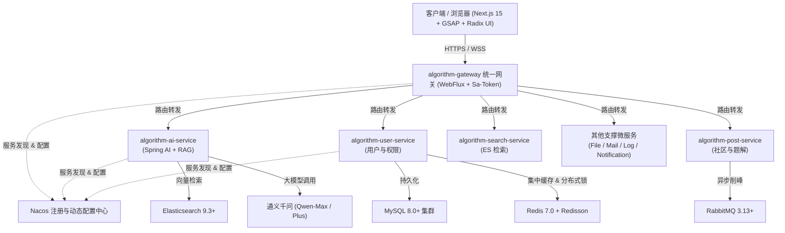

# 02 架构与设计体系 (Design)

> 本阶段负责定义 **衍序 · AlgoFlow** 的总体技术架构、微服务工程拓扑、Apple 极简设计语言、数据持久化与 RAG 向量引擎技术方案，为产品功能实现与研发交付提供坚实的技术底座。

---

## 🏛️ 设计核心原则

1. **服务解耦与契约优先**：后端微服务间绝对隔离，统一通过 `algorithm-api/*` 声明式 Feign 接口交互，禁止直接依赖服务实现模块；
2. **Apple 极简主义与内容为王**：前端交互界面去繁就简，以 Action Blue (`#0066cc`) 为唯一交互核心，将视觉焦点完全让位于算法演进与代码逻辑；
3. **领域感知与低幻觉 RAG**：AI 导师深度绑定当前步进演算上下文，依托结构化分块向量检索，实现高精准度、可溯源的教学解惑；
4. **统一 Monorepo 工程规范**：严格遵循《阿里巴巴 Java 开发手册》与 Next.js 15 App Router 最佳实践。

---

## 📂 设计文档目录结构

```text
docs/design/
├── README.md                  # 设计体系概览与架构原则（本文档）
├── architecture.md            # 系统总体微服务架构与通信设计
├── ui-ux.md                   # Apple 极简视觉与高帧率动效设计系统
├── data-model.md              # 数据库持久化、缓存与索引模型设计
└── rag-architecture.md        # 领域 RAG 算法导师架构与流式编排
```

---

## 🔄 系统全景拓扑图



---

## 🔗 下一步流程
- 查阅 [微服务架构设计 (architecture.md)](./architecture.md)；
- 查阅 [UI/UX 设计系统 (ui-ux.md)](./ui-ux.md)；
- 查阅 [数据模型设计 (data-model.md)](./data-model.md)；
- 查阅 [RAG 导师架构 (rag-architecture.md)](./rag-architecture.md)；
- 流转至阶段三：[产品需求文档 (PRD)](../prd/README.md)。
