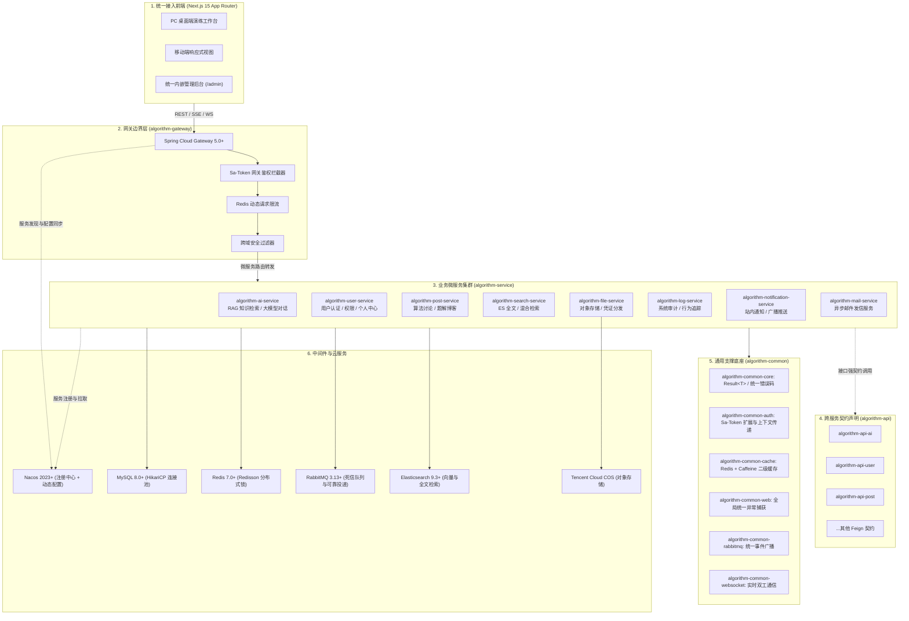

# 微服务架构与系统工程设计 (System Architecture)

> **文档编号**：DES-ARCH-001  
> **所属模块**：02. Design  
> **技术基线**：Java 21 / Spring Boot 3.5 / Spring Cloud 2025 / Next.js 15 App Router

---

## 1. 总体架构拓扑

AlgoFlow 采用现代化、高可用、可水平扩展的微服务架构。系统划分为客户端接入层、网关边界层、核心业务微服务层、公共基础设施层及中间件支撑层。



---

## 2. 关键架构设计与交互协议

### 2.1 网关路由与统一鉴权 (Gateway & Sa-Token)
* **网关统一拦截**：所有客户端外部流量必须经由 `algorithm-gateway`。
* **认证鉴权下沉网关**：网关利用 `Sa-Token` Gateway 模式集中校验 Token 状态，并解析出用户 ID、角色（`UserRoleEnum`），通过 HTTP Header 透传（`x-user-id`, `x-user-role`）至下游下游微服务。
* **白名单与安全放行**：对算法公共知识库、首页静态展示、公开题解、登录注册接口放行；对管理后台路由（`/api/admin/**`）严格做管理员权限判定。

### 2.2 跨服务调用规范 (OpenFeign 契约)
微服务之间严禁引入彼此的 `algorithm-*-service` 实现模块，所有跨服务通信统一遵循：
1. **调用方**：仅引入依赖服务声明的契约模块，例如 `algorithm-api-user`；
2. **声明接口**：Feign Client 接口统一放在 `com.stephen.cloud.api.*.client` 包下；
3. **熔断与降级**：所有 Feign 请求均配置全局重试策略与超时控制，网络抖动时不波及上下游链条。

### 2.3 统一返回实体与异常控制
遵循《阿里巴巴 Java 开发手册》强制规范：
```java
// 统一返回实体
public class Result<T> implements Serializable {
    private Integer code;    // 状态码：0-成功，其他-具体业务错误码
    private T data;          // 泛型业务数据载荷
    private String message;   // 状态描述或友好提示
    private Long timestamp;  // 时间戳
}
```
* **全局异常拦截**：`algorithm-common-web` 提供 `@RestControllerAdvice`，拦截业务异常 `BusinessException` 与系统未捕获异常，包装为标准错误码 `Result<Void>` 返回，绝不直接将底层 SQL 语法错误或调用栈暴露给前端。

### 2.4 二级缓存架构与分布式锁
1. **一级缓存**：使用 Caffeine 本地缓存（TTL = 60s ~ 300s），缓存高频读取且变动极低的算法元数据、分类目录；
2. **二级缓存**：使用 Redis 7.0 集群，针对用户会话、算法点赞数、热点题解使用 Redis String/Hash 存储；
3. **分布式并发控制**：涉及点赞累加、库存或防重复提交场景，使用 Redisson 分布式锁，加锁超时时间合理设置，保证幂等。

---

## 3. 前端工程架构与边界 (Frontend Architecture)

* **Next.js 15 App Router**：
  - 核心页面采用 RSC（React Server Components）加速首屏与 SEO；
  - 算法演示画布、GSAP 控制器、RAG 聊天抽屉等高交互区域下沉为客户端组件（`'use client'`）。
* **算法状态引擎与 Zustand**：
  - 算法逻辑与 UI 组件彻底解耦。`src/lib/algorithms/` 包含纯 TypeScript 实现的算法生成器，统一产出标准步骤日志（`AlgorithmStep[]`）；
  - `src/store/` 统一管理播放状态机（Current Step、Playing、Speed、Array Snapshot），实现任意跳步与回溯；
  - GSAP 通过监听 Store 中的快照变化，对 DOM 柱状图或 SVG 进行补间硬件加速渲染。
