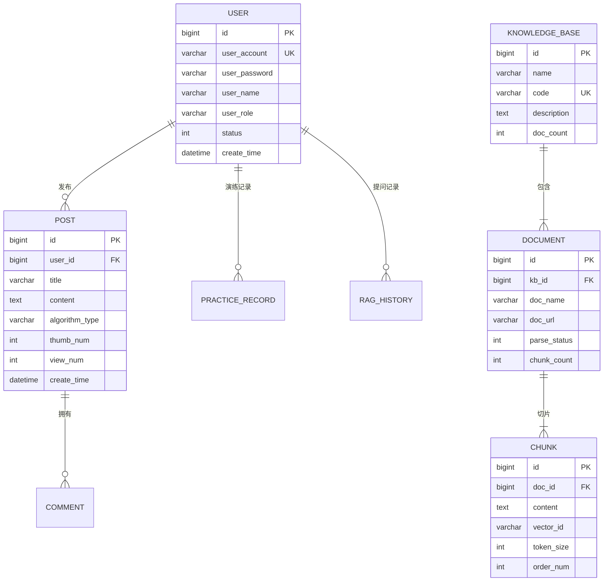

# 数据模型与缓存架构设计 (Data Model & Cache Architecture)

> **文档编号**：DES-DATA-001  
> **所属模块**：02. Design  
> **持久化引擎**：MySQL 8.0+ / Redis 7.0+ / Elasticsearch 9.3+

---

## 1. 核心实体与领域数据模型 (Domain Entities)

微服务各领域根据 DDD 思想独立拆分表结构，遵循第三范式并适度做读性能冗余：



---

## 2. 关系型数据库表设计规约 (MySQL DDL)

### 2.1 基础建表原则
1. **主键策略**：一律采用 `bigint unsigned NOT NULL AUTO_INCREMENT` 或分布式雪花 ID，禁止无序 UUID 作为主键；
2. **通用审计字段**：所有表必须包含 `create_time datetime DEFAULT CURRENT_TIMESTAMP`、`update_time datetime DEFAULT CURRENT_TIMESTAMP ON UPDATE CURRENT_TIMESTAMP` 及 `is_delete tinyint DEFAULT 0`；
3. **字符集规范**：统一采用 `utf8mb4` 字符集与 `utf8mb4_unicode_ci` 排序规则，支持 Emoji 表情。

---

## 3. 分布式缓存与 Redis 设计 (Cache Topology)

### 3.1 键名命名空间规范
统一格式：`业务前缀:模块:唯一标识:属性`

| 业务场景 | Key 格式 | 数据类型 | 典型 TTL | 策略与规约 |
| :--- | :--- | :--- | :--- | :--- |
| **用户 Token 鉴权** | `algoflow:auth:token:{tokenValue}` | String | 7 天 | Sa-Token 维护，登录成功写入，注销删除 |
| **算法演练元数据** | `algoflow:algo:meta:{algoKey}` | String / JSON | 24 小时 | Caffeine 一级 + Redis 二级，后台变更主动清退 |
| **文章点赞计数** | `algoflow:post:thumb:{postId}` | Set (UserIds) | 永久 (异步落库) | 判定重复点赞与高性能计数累加 |
| **接口防刷限流** | `algoflow:ratelimit:{ip}:{apiUri}` | Int (Counter) | 60 秒 | Redis Lua 脚本原子自增与滑动窗口判定 |
| **知识库切片锁** | `algoflow:lock:chunk:{docId}` | Redisson Lock | 30 秒 (自动续期)| 防止对同一文档重复并发切片向量化 |

---

## 4. Elasticsearch 索引设计 (Search & Vector Index)

知识库切片索引 `algoflow_knowledge_chunk` 结构设计：

```json
{
  "mappings": {
    "properties": {
      "chunkId": { "type": "keyword" },
      "kbCode": { "type": "keyword" },
      "algorithmType": { "type": "keyword" },
      "title": { "type": "text", "analyzer": "ik_max_word" },
      "content": { "type": "text", "analyzer": "ik_max_word" },
      "contentVector": {
        "type": "dense_vector",
        "dims": 1536,
        "index": true,
        "similarity": "cosine"
      },
      "tags": { "type": "keyword" },
      "createTime": { "type": "date" }
    }
  }
}
```
* **混合检索策略 (Hybrid Search)**：采用 BM25 关键词分词检索与 Cosine 向量语义相似度打分加权融合（Weight: 0.3 BM25 + 0.7 Vector），兼顾专业术语强匹配与长句泛化理解。
