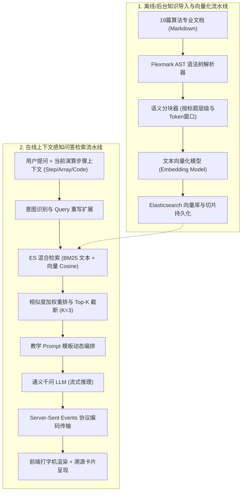

# RAG 算法导师与知识检索架构设计 (RAG Architecture)

> **文档编号**：DES-RAG-001  
> **所属模块**：02. Design  
> **核心引擎**：Spring AI Alibaba + 通义千问 (Qwen-Max/Plus) + Elasticsearch 9.3+

---

## 1. RAG 核心流水线 (End-to-End Pipeline)

为了杜绝大模型在复杂算法推演中的幻觉问题，AlgoFlow 构建了严格基于领域知识图谱的闭环增强型检索系统：



---

## 2. 算法文档语义切片策略 (Chunking Strategy)

* **层次化分块 (Hierarchical Splitting)**：
  - 基于 Flexmark 解析 Markdown 标题树，以 `## 核心原理`、`### 步骤演算`、`### 复杂度分析` 为天然语义分界；
  - 保证每一个切片包含完整的算法上下文（如包含前序标题层级：`快速排序 > 双指针分区策略 > 基准值选择`）；
* **分块窗口与重叠 (Chunk Window & Overlap)**：
  - 单切片 Token 大小控制在 `400 ~ 800 tokens`；
  - 设置 `100 tokens` 的重叠滑窗，防止算法关键推导逻辑在截断边缘断裂；
* **元数据注入 (Metadata Enrichment)**：
  - 每个切片均附带 `algorithmType`、`topic`、`difficulty`、`codeSnippet` 等元数据，支持精确元数据前置过滤。

---

## 3. 上下文感知 Prompt 工程 (Context-Aware Prompt Engineering)

系统在构建 Prompt 时，将演练工作台的实时遥测数据与检索切片深度拼合：

```text
[系统角色]
你是 AlgoFlow 专属的算法教学导师“衍序小助手”。你的任务是根据给定的【权威知识切片】以及学习者当前的【演练工作台状态】，用通俗、严谨、循序渐进的方式解答学生的疑问。

[演练工作台上下文快照]
- 正在学习算法: {algorithmName}
- 当前演练步数: 第 {currentStep} 步 / 共 {totalSteps} 步
- 当前数组状态: {arraySnapshot}
- 当前活动指针: {activePointers}
- 当前执行代码行号: 第 {highlightLine} 行: `{codeLineText}`
- 累计比较次数: {comparisonCount}, 累计交换次数: {swapCount}

[召回的权威知识库切片]
{retrievedChunks}

[回答要求]
1. 直接针对学生当前步骤的困惑进行解答，说明当前比较或交换的具体原因；
2. 严格基于知识库切片内容，不得臆造未经验证的算法结论（杜绝幻觉）；
3. 关键变量与公式使用 LaTeX 规范排版，行内代码使用反引号包裹；
4. 语言风格鼓励、专业、富有启发性。
```

---

## 4. 流式响应协议 (Server-Sent Events 规范)

前端与后端建立全双工或单向 SSE 连接：`POST /api/ai/rag/chat/stream`

### 4.1 数据帧格式
```text
event: message
data: {"type": "content", "delta": "在当前第 3 步中，算法选定基准值为 42..."}

event: source
data: {"type": "source", "sources": [{"docTitle": "06-快速排序.md", "section": "三数取中法优化", "score": 0.89}]}

event: done
data: {"type": "done", "finishReason": "stop"}
```

### 4.2 异常与流控保障
* **断线重连**：利用标准 SSE `Last-Event-ID` 机制与心跳包（每 15 秒下发 `:keep-alive`），杜绝代理超时切断长连接；
* **客户端主动终止**：用户点击“停止生成”时，前端 `AbortController` 触发中断，后端监听到连接挂起立即释放大模型推理资源。
