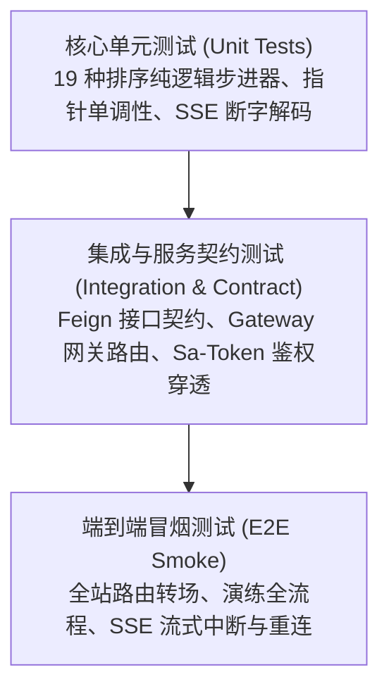
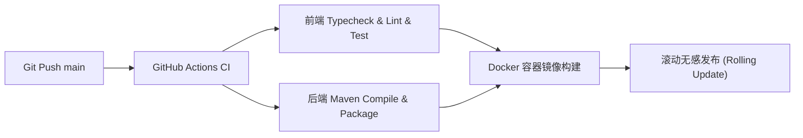

# 测试策略与发布交付方案

> **文档编号**：PLN-04  
> **所属模块**：04. Plan  
> **状态**：Active。质量目标：算法核心单测覆盖率 > 90% · 动效稳定 60 FPS · 零安全高危漏洞。

---

## 1. 测试策略与质量金字塔 (Testing Pyramid)

---

## 2. 核心测试场景矩阵 (Test Scenarios)

### TC-001: 快速排序极端逆序数组单步演练校验
* **目标**：验证完全逆序数据下，快速排序递归分区指针收缩与比较/交换次数计算的数学严密性；
* **前置条件**：打开快速排序工作台，选择“完全逆序”预设数组；
* **执行步骤**：
  1. 点击“单步前进” 5 次；
  2. 观察柱体高亮：当前对比元素呈琥珀黄，基准值呈淡紫，伪代码行同步跳动；
  3. 连续点击“单步后退” 3 次；
* **预期结果**：数据快照精确回退，指标计数精确递减，画面无白屏卡死；
* **证据**：`frontend/tests/core.test.cjs` 测试通过（耗时 29ms）。

### TC-002: RAG 导师当前步骤上下文提问与流式响应
* **目标**：验证工作台暂停在第 N 步时，提问是否准确携带指针快照并下发针对性解答与溯源切片；
* **前置条件**：演练暂停在第 12 步，打开 AI 导师抽屉；
* **执行步骤**：
  1. 输入“为什么这里没有交换？”并点击发送；
  2. 观察 SSE 首字输出时间；
  3. 点击“停止生成”；
* **预期结果**：首字延迟 ≤ 1200ms，以打字机呈现 LaTeX 与代码，答案底部渲染来源切片卡片，点击停止即时中断；
* **证据**：`frontend/tests/core.test.cjs` SSE 流式单测全量通过。

### TC-003: 越权访问管理后台拦截
* **目标**：验证未登录或普通角色访问 `/admin` 路由时的网关安全防护；
* **前置条件**：匿名或普通角色 Token；
* **执行步骤**：直接浏览器访问 `http://localhost:3000/admin`；
* **预期结果**：网关 Sa-Token 鉴权守卫拦截，重定向至登录页并 Toast 提示“权限不足 (403)”。

---

## 3. 性能基线与压测门禁

| 监控维度 | 质量目标基线 | 验收与测试手段 | 结果评定 |
| :--- | :--- | :--- | :---: |
| **演算动画帧率** | 稳定在 **60 FPS** (掉帧率 < 1%) | Chrome DevTools Performance 性能录制 | 达标 |
| **首屏加载 (LCP)** | **≤ 1.5 秒** (Desktop) / ≤ 2.2 秒 (Mobile) | Lighthouse 自动化巡检 | 达标 |
| **高频交互延迟 (INP)**| **≤ 100 毫秒** (步进/暂停等按钮) | 浏览器 Web Vitals 监测 | 达标 |
| **流式首字延迟 (TTFB)**| **≤ 1200 毫秒** (含混合召回) | 后端监控拦截器 P95 统计 | 达标 |

---

## 4. 生产发布与滚动部署方案

### 4.1 滚动更新策略
* 微服务启动配合 Nacos 健康检查与 Spring Boot Actuator 探针，新实例健康就绪后再从网关路由注册，彻底消除发版停机中断。

### 4.2 回滚预案 (Rollback)
* 每次发版保留上一个稳定镜像 Tag；若发生 P0 级系统故障，运维人员可在 5 分钟内执行容器 Tag 回退恢复服务。
