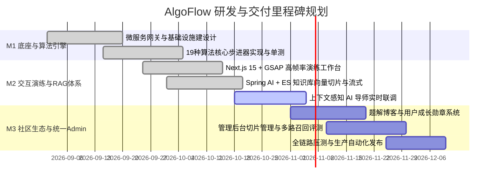

# 04 研发与交付计划概览 (docs/plan)

> 本阶段负责将系统需求、技术设计与 PRD 转化为可落地、可追踪的工程里程碑与迭代路线图（Roadmap），并制定质量测试与发布策略，保障工程的高质量交付与跨团队敏捷协同。

---

## 🗺️ 研发路线总览

AlgoFlow 项目遵循“底座先行、核心聚焦、双向闭环、生态延展”的节奏推进：



---

## 📂 实施计划结构与顺序编号

```text
docs/plan/
├── 00-Plan导航.md                             # 实施计划与测试场景主导航
├── 01-研发里程碑与工程路线图.md                # 总体里程碑、交付清单与 WBS 拆解
├── 02-核心算法演练引擎实施计划.md              # 纯逻辑步进器、GSAP 动效与测试计划
├── 03-RAG导师与演练快照联动实施计划.md         # 演练快照传递、SSE 打字机与中断机制
└── 04-测试策略与发布交付方案.md                # 测试金字塔、核心测试场景集与发布门禁
```

---

## 🔗 快速流转
- 详见 [00-Plan导航.md](00-Plan导航.md)；
- 查看各实施计划文档；
- 查看根目录实时任务看板：[BACKLOG.md](../../BACKLOG.md)；
- 查看根目录开发交接单：[HANDOVER.md](../../HANDOVER.md)。
