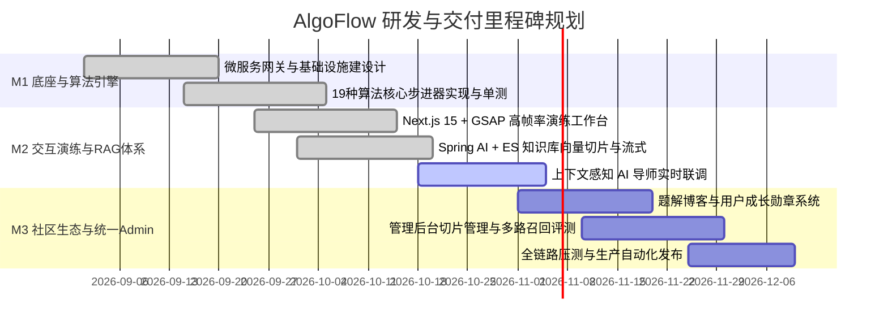

# 04 研发与交付计划 (Plan)

> 本阶段负责将系统需求、技术设计与 PRD 转化为可落地、可追踪的工程里程碑与迭代路线图（Roadmap），并制定质量测试与发布策略，保障工程的高质量交付与跨团队敏捷协同。

---

## 🗺️ 研发路线总览

AlgoFlow 项目遵循“底座先行、核心聚焦、双向闭环、生态延展”的节奏推进：

---

## 📂 计划文档矩阵

| 文档名称 | 核心内容定位 |
| :--- | :--- |
| **[里程碑与迭代路线图](./milestone-roadmap.md)** | 详细定义 M1~M3 各阶段的目标、交付物清单、工作拆解 (WBS) 及当前完成状态 |
| **[测试与发布交付方案](./test-and-release-plan.md)** | 前后端自动化测试矩阵、性能指标基线、CI/CD 质量流水线门禁与部署上线方案 |

---

## 🔗 协同说明
* 实时任务看板详见根目录 **[BACKLOG.md](../BACKLOG.md)**；
* 接力交接指引详见根目录 **[HANDOVER.md](../HANDOVER.md)**。
