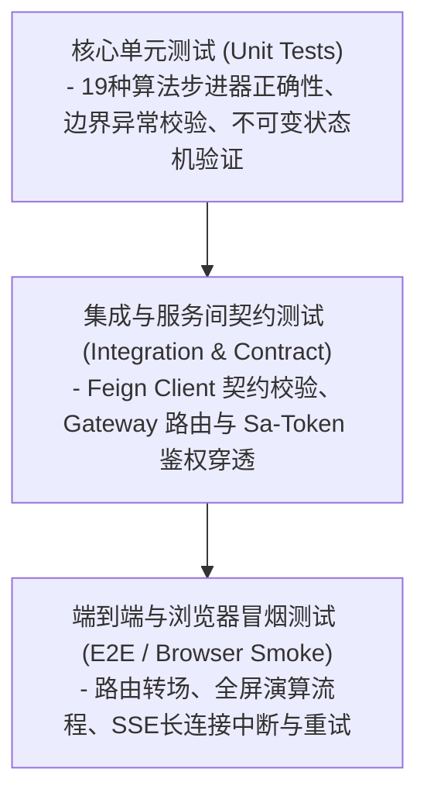
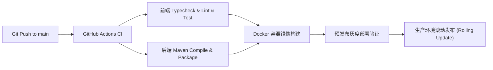

# 测试策略与交付发布方案 (Test & Release Plan)

> **文档编号**：PLN-REL-001  
> **所属模块**：04. Plan  
> **质量目标**：核心算法测试覆盖率 > 90% · 动效稳定 60 FPS · 零安全高危漏洞

---

## 1. 质量门禁与测试金字塔 (Testing Pyramid)



### 1.1 前端测试矩阵
* **核心算法步进器测试** (`frontend/tests/core.test.cjs`)：
  - 覆盖排序结果有序性、输入数组防篡改保护、指针标识准确性、稳定性（Stability）检验；
  - 覆盖极端数据集（负数、全等数组、单元素数组、基数排序非法输入拦截）；
  - 覆盖 SSE 分块解析（Split UTF-8、多行字段、注释过滤与 Abort 终止机制）。
* **自动化指令**：
  ```bash
  cd frontend
  npm run typecheck    # 严格 TypeScript 类型无报错
  npm test             # 核心逻辑单测全绿 (17/17)
  npm run lint         # ESLint 代码风格与规范扫描
  ```

### 1.2 后端测试与编译矩阵
* **微服务编译与语法校验**：
  ```bash
  cd backend
  mvn clean test-compile
  mvn -B package -DskipTests
  ```

---

## 2. 动效与性能指标基线 (Performance Benchmarks)

| 测试维度 | 质量指标目标 | 监控/测试手段 |
| :--- | :--- | :--- |
| **演算动画帧率** | 稳定在 **60 FPS** (掉帧率 < 1%) | Chrome DevTools Performance 性能面板记录 |
| **首屏渲染 (LCP)** | **≤ 1.5 秒** (Desktop) / ≤ 2.2 秒 (Mobile) | Lighthouse / Web Vitals 自动化监测 |
| **用户交互延迟 (INP)** | **≤ 100 毫秒** (步进/暂停等高频按钮) | 浏览器性能追踪 |
| **AI 流式首字延迟 (TTFB)** | **≤ 1200 毫秒** (含混合检索召回) | 后端监控拦截器统计 P95 耗时 |

---

## 3. 生产发布与持续部署方案 (CI/CD & Deployment)



### 3.1 部署策略
* **容器编排**：统一基于 `docker-compose.yml` 与 `docker-compose-env.yml` 构建生产级容器拓扑；
* **滚动更新与无感重启**：微服务启动配合 Nacos 健康检查与探针（Actuator Health），确保新实例就绪后再剔除旧实例；
* **回滚预案 (Rollback Strategy)**：每次发布生成版本镜像 Tag，若产生严重 P0 故障，支持 5 分钟内一键回退上一个稳定 Tag。
