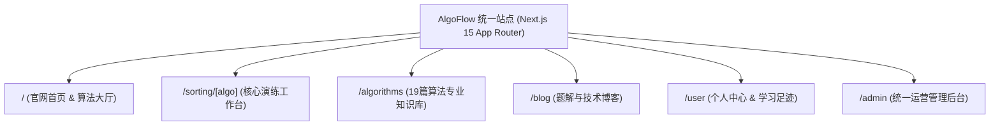
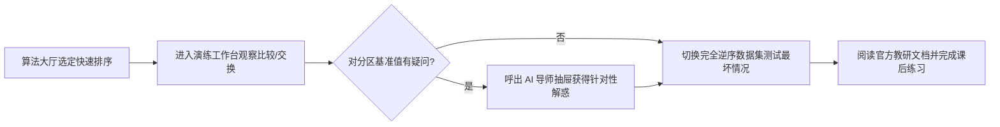

# 产品全景与信息架构PRD

> **文档编号**：PRD-01  
> **所属模块**：03. PRD  
> **唯一来源设计**：[设计01 平台顶层微服务架构设计](../design/01-平台顶层微服务架构设计.md) 与 [设计02 Apple极简视觉与高帧率动效设计](../design/02-Apple极简视觉与高帧率动效设计.md)  
> **原则**：PRD 明确范围到哪里、用户旅程与信息流转。实施状态统一只在 [BACKLOG.md](../../BACKLOG.md)。

---

## 1. 产品背景与定位

* **产品定位**：面向算法教学的 RAG 增强型交互式系统（推衍秩序 · 步进数据心流）；
* **用户群体**：计算机在校生、求职面试工程师、算法讲师与教研人员；
* **核心价值**：整合动态演练、AI 导师、算法专章知识库、题解社区与内嵌后台管理，打破教学工具的孤岛壁垒。

---

## 2. 范围与边界 (Scope & Boundaries)

### 2.1 包含功能 (In Scope)
* **首页与算法大厅**：核心算法卡片展示、算法特性对比与学习路径入口；
* **排序动态演练工作台**：19 种排序算法单步演练与多速控制；
* **RAG 算法导师侧边栏**：演练步骤感知与流式问答；
* **算法题解与社区**：技术博客阅读与发布；
* **个人成长中心**：用户足迹与算法打卡勋章；
* **内嵌统一管理后台**：知识库切片管理与召回评测实验室。

### 2.2 明确排除 (Out of Scope)
* 排除独立分立的外部 Admin Web 站点（强制内嵌在 App Router `/admin` 路由下）；
* 排除与算法无关的泛娱乐社区功能。

---

## 3. 信息架构与用户流程 (IA & User Journey)

### 3.1 站点信息架构 (Site Information Architecture)

### 3.2 典型用户学习主旅程

---

## 4. 功能规格与交互总则

* **全局导航栏**：常驻顶部，含品牌 Logo、核心算法快速切换下拉菜单、亮暗主题切换按钮、全站聚合搜索 Command Palette (`Cmd+K`) 与用户头像；
* **页面排版与层次**：采用 Apple 极简发丝线 (`hairline #e0e0e0`) 进行物理卡片隔离，严禁多余的浓重阴影；
* **加载与错误边界**：全站配备 Next.js 15 `loading.tsx` 骨架屏占位与 `error.tsx` 优雅降级捕获。

---

## 5. 非功能性需求 (NFR)

* **首屏性能**：Desktop 首屏 LCP ≤ 1.5s，Mobile LCP ≤ 2.2s；
* **交互延迟**：路由转场与模态框展开 INP ≤ 100ms；
* **无障碍设计**：满足 WCAG 2.1 AA 规范，全站支持键盘 Tab 导航。

---

## 6. 验收标准与交付清单

- [ ] 官网首页完整展示 19 种算法卡片，点击可无缝路由至 `/sorting/[algo]`；
- [ ] 顶部导航与页脚在各子页面保持一致性；
- [ ] 暗色模式与亮色模式切换流畅无闪烁；
- [ ] 对应单元测试通过率 100%。
