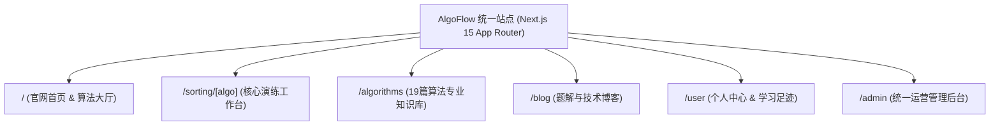
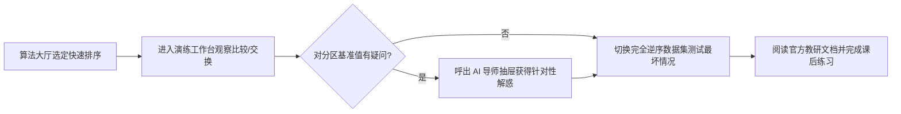

# 产品全景与信息架构PRD

> **文档编号**：PRD-01  
> **所属模块**：03. PRD  
> **唯一来源设计**：[设计01 平台顶层微服务架构设计](../design/01-平台顶层微服务架构设计.md) 与 [设计05 页面交互与动效](../design/05-shadcn顶部布局与全站交互规范.md)
> **原则**：PRD 明确范围到哪里、用户旅程与信息流转。实施状态统一只在 [BACKLOG.md](../../BACKLOG.md)。

---

## 1. 产品背景与定位

* **产品定位**：面向算法教学的 RAG 增强型交互式系统（推衍秩序 · 步进数据心流）；
* **用户群体**：计算机在校生、求职面试工程师、算法讲师与教研人员；
* **核心价值**：整合动态演练、AI 导师、算法专章知识库、题解社区与内嵌后台管理，打破教学工具的孤岛壁垒。

---

## 2. 范围与边界 (Scope & Boundaries)

### 2.1 包含功能 (In Scope)
* **首页与算法大厅**：核心算法卡片展示、算法特性对比与学习路径入口；
* **排序动态演练工作台**：19 种排序算法单步演练与多速控制；
* **RAG 算法导师侧边栏**：演练步骤感知与流式问答；
* **算法题解与社区**：技术博客阅读与发布；
* **用户认证与个人工作区**：邮箱密码登录、独立注册、个人资料、学习记录、内容、收藏、通知与账户安全；
* **内嵌统一管理后台**：知识库切片管理与召回评测实验室。

### 2.2 明确排除 (Out of Scope)
* 排除独立分立的外部 Admin Web 站点（强制内嵌在 App Router `/admin` 路由下）；
* 排除与算法无关的泛娱乐社区功能；
* 当前认证方案排除 GitHub / 第三方登录与邮箱验证码登录；邮件验证、找回密码和旧账户安全设置密码必须独立接通后再提供入口。

---

## 3. 信息架构与用户流程 (IA & User Journey)

### 3.1 站点信息架构 (Site Information Architecture)

### 3.2 典型用户学习主旅程

---

### 3.3 认证与用户旅程

1. 匿名用户从顶栏或受保护操作打开共享登录 Dialog，保留当前页面；弹窗展示 Logo A、邮箱、密码与注册入口。
2. 已有账户提交邮箱密码：失败显示明确反馈，成功建立会话、关闭 Dialog 并继续原任务；被替换的登录按钮将焦点交给头像。
3. 新用户切换注册：保留邮箱、清空密码，填写邮箱 / 密码 / 确认密码。成功先显示「账户已创建」，随后进入登录；不自动标记邮箱已验证，也不自动建立会话。
4. 登录 / 注册切换、密码显隐、错误与提交状态复用同一套 shadcn/Radix 组件；无第三方分隔区、验证码槽或无效的找回链接。
5. 头像菜单与个人中心遵循既有角色边界。安全页展示邮箱验证状态、邮箱密码方式和受控修改密码；公开主页仅展示公开资料。密码变更撤销旧会话；旧账户兼容与找回流程接通前不得假报可用。

字段、安全与迁移规则以 [REQ-01 FR-05](../requirement/01-产品总览与系统需求规格说明.md#fr-05-用户认证与个人中心-已确认) 为准，验收条件见 REQ-02 US-501 / US-502；邮箱密码接口、注册和改密已实现，真实本机与移动浏览器证据见 HANDOVER 和 BACKLOG `TSK-205`。独立邮件验证 / 找回、无旧会话账户恢复仍受邮件供应商配置约束。

---

## 4. 功能规格与交互总则

* **全局导航栏**：单层共享顶栏，Logo A、发现 / 算法学习 / 可视化演练 / 学习社区、搜索、通知、独立主题入口及头像；匿名展示登录，管理入口按服务端角色展示，不增加第二层导航；
* **页面排版与层次**：遵循 [主设计规范](../DESIGN.md)，通过留白、底色和对齐组织无装饰边框界面，保留键盘焦点与错误反馈；
* **加载与错误边界**：全站配备 Next.js 15 `loading.tsx` 骨架屏占位与 `error.tsx` 优雅降级捕获。

---

## 5. 非功能性需求 (NFR)

* **首屏性能**：Desktop 首屏 LCP ≤ 1.5s，Mobile LCP ≤ 2.2s；
* **交互延迟**：路由转场与模态框展开 INP ≤ 100ms；
* **无障碍设计**：满足 WCAG 2.1 AA 规范，全站支持键盘 Tab 导航。

---

## 6. 验收标准与交付清单

- [ ] 官网首页完整展示 19 种算法卡片，点击可无缝路由至 `/sorting/[algo]`；
- [ ] 顶部导航与页脚在各子页面保持一致性；
- [ ] 暗色模式与亮色模式切换流畅无闪烁；
- [ ] 对应单元测试通过率 100%。
