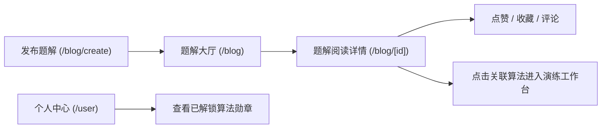

# 社区讨论与题解博客PRD

> **文档编号**：PRD-04  
> **所属模块**：03. PRD  
> **唯一来源设计**：[设计01 平台顶层微服务架构设计](../design/01-平台顶层微服务架构设计.md) 与 [设计03 数据模型持久化与缓存架构设计](../design/03-数据模型持久化与缓存架构设计.md)  
> **前端入口**：`frontend/src/app/blog/` / `frontend/src/app/user/`  
> **后端契约**：`algorithm-api-post` / `algorithm-api-user`

---

## 1. 产品背景与定位

将单一的工具演示升维为活跃的**算法学习与知识共创社区**。提供图文题解发布、沉浸式 Markdown 阅读、算法学习足迹记录与成就勋章激励，形成从“学习演练”到“输出题解”的正向心流。

---

## 2. 范围与边界 (Scope & Boundaries)

### 2.1 包含功能 (In Scope)
* **题解博客流**：多维筛选（算法类别、难度、热度、最新）；
* **Markdown 沉浸式阅读器**：代码高亮、一键复制、TOC 大纲跟随；
* **在线文章编辑器**：Split View 实时预览、草稿本地暂存、封面上传；
* **互动体系**：点赞、收藏与二级嵌套评论；
* **用户成长中心**：19 种算法打卡完成度、个人足迹与勋章。

### 2.2 明确排除 (Out of Scope)
* 本期不引入付费专栏或资金充值提现逻辑。

---

## 3. 信息架构与用户流程

---

## 4. 功能详细规格与交互规则

### 4.1 题解发布与编辑器规范
* **编辑器**：基于 Markdown 语法，左侧输入，右侧实时渲染；
* **草稿保护**：每次输入后通过防抖（debounce 1000ms）自动写入 LocalStorage；
* **关联算法**：发布时必选关联的排序算法类型（如“归并排序”），并在演练工作台对应页面推荐该题解。

### 4.2 个人成长体系与勋章规则
* **秩序启蒙者**：完成前 3 种基础排序（冒泡、选择、插入）演练与答疑；
* **分治大师**：完成归并排序与快速排序的所有极端数据集测试；
* **心流学者**：与 RAG 导师互动问答达 20 次。

---

## 5. 非功能性需求 (NFR)

* **内容安全**：Markdown 渲染前端严格执行 DOMPurify XSS 净化；
* **高并发点赞**：Redis 集合抗并发，避免数据库行级死锁；
* **响应时间**：文章详情页首屏加载 ≤ 1.2s。

---

## 6. 验收标准与交付清单

- [ ] 文章发布成功后在列表页即时呈现；
- [ ] 点赞数字实时响应，再次点击取消点赞；
- [ ] 个人中心准确显示 19 种算法掌握进度条。
