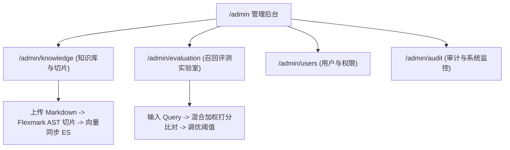

# 统一运营与知识库切片管理后台PRD

> **文档编号**：PRD-05  
> **所属模块**：03. PRD  
> **唯一来源设计**：[设计01 平台顶层微服务架构设计](../design/01-平台顶层微服务架构设计.md) 与 [设计04 RAG算法导师与知识检索设计](../design/04-RAG算法导师与知识检索设计.md)  
> **前端入口**：`frontend/src/app/admin/` (严格禁止独立工程)  
> **权限控制**：网关 Sa-Token 路由守卫 (`UserRoleEnum.ADMIN`)

---

## 1. 产品背景与定位

为平台教研管理员与运维团队提供统一的后台运营控制台。用于维护 19 篇算法官方知识库切片、调优向量嵌入参数、进行多路召回效果评测，并监控系统全站 API 访问日志与异常告警。

---

## 2. 范围与边界 (Scope & Boundaries)

### 2.1 包含功能 (In Scope)
* **知识库与切片管理 (`/admin/knowledge`)**：Markdown 文档上传、自动分块预览、切片文本手工微调与重新向量化；
* **召回评测实验室 (`/admin/evaluation`)**：输入测试 Query，同屏比对 BM25 文本与 Cosine 向量检索得分与召回切片；
* **用户与权限管理 (`/admin/users`)**：用户列表、角色变更、会话强退与封禁；
* **全站审计与日志 (`/admin/audit`)**：API 访问耗时（P95/P99）监控、异常堆栈追踪与发信记录。

### 2.2 明确排除 (Out of Scope)
* 严禁将后台拆分成独立的前端仓库，全量集成在 `frontend/src/app/admin/` 统一维护。

---

## 3. 信息架构与用户流程

---

## 4. 功能详细规格与交互规则

### 4.1 知识切片微调与重新向量化
* **切片表格**：展示切片 ID、所属文档、所属层级标题、Token 长度、向量同步状态；
* **在线编辑弹窗**：支持教研员手动编辑特定切片中的公式或措辞，点击保存自动重新调用 Embedding API 刷新 ES 向量索引。

### 4.2 召回评测实验室
* 输入测试 Query（如“快速排序为什么会退化到 $O(n^2)$？”）；
* 点击“开始评测”，同屏输出两列对比：
  - 左列：纯 BM25 关键词匹配得分与切片；
  - 右列：1536 维 Cosine 向量相似度得分与切片；
  - 汇总：综合加权得分与最终入选 Top-3 切片。

---

## 5. 非功能性需求 (NFR)

* **访问安全**：普通用户或未登录状态直接访问 `/admin/**` 时，网关返回 403 并重定向至登录页；
* **切片并发锁**：同一文档的切片向量化操作由 Redisson 分布式锁保护，防止并发重复切片。

---

## 6. 验收标准与交付清单

- [ ] 非管理员账号完全无法加载 `/admin` 路由内容；
- [ ] 上传 Markdown 后能正确按 H1/H2/H3 生成切片并完成向量化；
- [ ] 召回实验室能够实时返回双路对比检索结果与打分。
