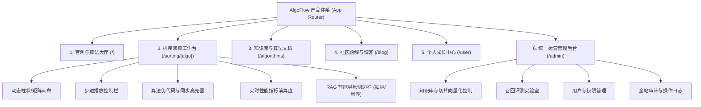

# 03 产品需求文档体系概览 (docs/prd)

> 本阶段负责将业务与系统需求具象化为产品功能规范、用户交互原型流转、界面信息架构（IA）以及各子系统的详细产品规格，作为研发与测试验收的核心交付基准。

---

## 🗺️ 产品信息架构 (Information Architecture)

AlgoFlow 整体围绕**“看算法推演、问 AI 导师、学原理知识、练面试题解、管系统运营”**五大核心场景展开：



---

## 📂 PRD 文档结构与顺序编号

```text
docs/prd/
├── 00-PRD导航.md                              # 产品需求文档主导航与来源映射表
├── 01-产品全景与信息架构PRD.md                 # 全站信息架构、用户旅程与路由体系
├── 02-算法动态演练工作台PRD.md                 # 19 种排序算法动态画布、多速步进、指标演算
├── 03-RAG增强型AI算法导师PRD.md                # 步骤感知提问、流式打字机答疑、知识溯源卡片
├── 04-社区讨论与题解博客PRD.md                 # 图文题解发布、Markdown 阅读器、勋章打卡
└── 05-统一运营与知识库切片管理后台PRD.md        # 内嵌 Admin 路由、切片微调、召回评测实验室
```

---

## 🔗 快速流转
- 详见 [00-PRD导航.md](00-PRD导航.md)；
- 查看各产品需求文档；
- 流转至阶段四：[04. 研发与交付计划 (docs/plan)](../plan/00-Plan导航.md)。
