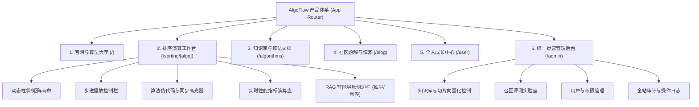

# 03 产品需求文档体系 (Product Requirements Document - PRD)

> 本阶段负责将业务与系统需求具象化为产品功能规范、用户交互原型流转、界面信息架构（IA）以及各子系统的详细产品规格，作为研发与测试验收的核心交付基准。

---

## 🗺️ 产品信息架构 (Information Architecture)

AlgoFlow 整体围绕**“看算法推演、问 AI 导师、学原理知识、练面试题解、管系统运营”**五大核心场景展开：

---

## 📂 PRD 文档矩阵索引

| 序号 | PRD 文档名称 | 核心功能覆盖 | 目标受众 |
| :--- | :--- | :--- | :--- |
| **01** | [算法演练工作台 PRD](./prd-sorting-visualizer.md) | 19种排序算法动态画布、多速步进、指针高亮、自定义输入、指标演算 | 算法初学者 / 面试复习者 |
| **02** | [RAG AI 算法导师 PRD](./prd-ai-mentor.md) | 步骤感知提问、流式打字机答疑、知识库溯源引用卡片、快捷引导提问 | 遇到逻辑卡点的学习者 |
| **03** | [社区与学习成长 PRD](./prd-community-and-learning.md) | 算法深度教程、图文题解发布、点赞评论互动、学习打卡与足迹 | 进阶工程师 / 知识创作者 |
| **04** | [统一运营管理后台 PRD](./prd-admin-ops.md) | 知识库切片管理、大模型参数调优、多路召回实验室、系统安全审计 | 教学教研管理员 / 运维人员 |

---

## 🔗 下一步流程
- 阅读各功能模块具体 PRD 规范；
- 流转至阶段四：[研发与交付计划 (Plan)](../plan/README.md)。
