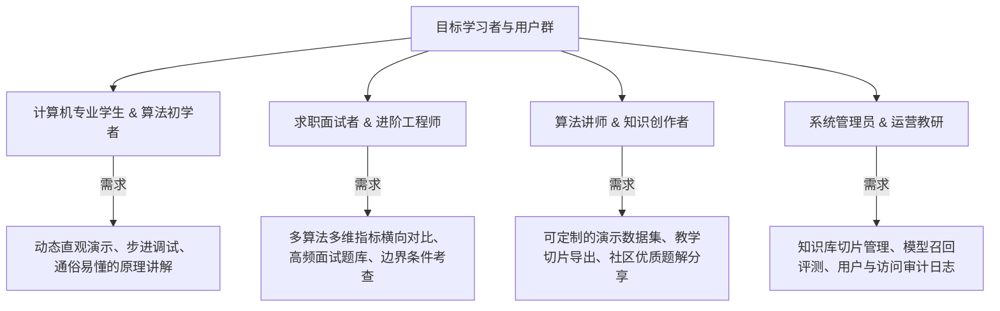

# 01 需求体系 (Requirement)

> 本阶段负责定义 **衍序 · AlgoFlow** 的产品使命、业务目标、用户画像及痛点场景，输出清晰的需求规格与敏捷用户故事，为系统架构设计（Design）与产品功能细化（PRD）提供输入。

---

## 🎯 业务目标与价值主张

传统算法教学存在三大典型痛点：
1. **抽象晦涩**：伪代码与纯文本难以具象化数据指针在内存中的移动与交换过程；
2. **缺乏即时反馈**：遇到逻辑卡点时无专业答疑，通用大模型回答往往脱离具体实现上下文或产生严重知识幻觉；
3. **教学工具割裂**：演练工具、技术博客、理论教材三者分离，学习者心流频繁被打断。

**AlgoFlow 的核心定位**：
以**“高帧率算法可视化演练 + 领域感知 RAG 增强导师 + Apple 极简沉浸交互”**为三角支柱，构建从“感性认知”到“理性推理”，再到“工程实战”的一体化教学体系。

---

## 📂 需求文档结构

```text
docs/requirement/
├── README.md                  # 需求体系概览（本文档）
├── system-requirements.md     # 系统需求规格说明书 (SRS/URS)
└── user-stories.md            # 敏捷用户故事与验收准则 (User Stories & AC)
```

---

## 👥 用户画像矩阵



---

## 🔗 下一步流程
- 阅读 [系统需求规格说明书 (system-requirements.md)](./system-requirements.md) 获取详细的功能性与非功能性需求定义；
- 查看 [用户故事与验收准则 (user-stories.md)](./user-stories.md) 获取敏捷任务拆解依据；
- 流转至阶段二：[系统架构与设计 (Design)](../design/README.md)。
