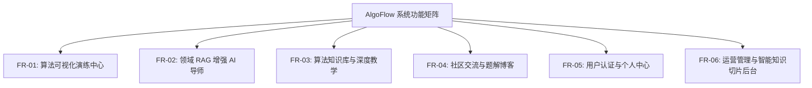

# 系统需求规格说明书 (System Requirements Specification)

> **文档编号**：REQ-SRS-001  
> **所属模块**：01. Requirement  
> **状态**：Approved / Living Document  
> **基准版本**：v1.0.0

---

## 1. 引言与背景

### 1.1 编写目的
本文档详细规定 **衍序 · AlgoFlow** 系统的业务需求、功能性需求（FR）与非功能性需求（NFR），作为系统架构设计（Design）、产品详细规划（PRD）、测试用例编制及验收交付的标准可信源。

### 1.2 业务背景与目标
数据结构与算法是现代计算机科学与软件工程的基石。在经典教学中，学生通常面临“静态伪代码抽象”、“动态指针与数组交换过程缺乏直观具象化”、“学习遇到阻碍时无人指导”的困境。AlgoFlow 的目标是构建一个将**高帧率动态演练**与**领域 RAG 大模型 AI 导师**紧密结合的沉浸式在线平台，显著降低排序算法的认知门槛，提升学习效率与心流体验。

---

## 2. 系统范围与功能性需求 (Functional Requirements)

### 2.1 FR-01: 核心排序算法动态演练工作台
* **FR-01.1 算法矩阵支持**：系统必须支持全量 19 种主流排序算法（含冒泡、选择、插入、希尔、快速、归并、堆排序、计数、桶、基数排序等及衍生高级排序）。
* **FR-01.2 步进与播放控制**：提供播放/暂停、单步前进（Step Next）、单步后退（Step Prev）、调速滑块（0.25x ~ 4.0x）、重置及自动循环播放。
* **FR-01.3 自定义与随机数据集**：支持随机生成、近乎有序、完全逆序、存在大量重复值等数据形态，且允许用户手动输入自定义数组并校验输入合法性。
* **FR-01.4 状态与指针高亮**：精准呈现“当前比较区间”、“左右指针位置”、“基准值 (Pivot)”、“已排序区域”及“交换瞬时状态”，高亮颜色符合无障碍色彩对比。
* **FR-01.5 性能指标实时演算**：在每一步演算过程中，动态累加并显示比较次数 (Comparisons)、交换/赋值次数 (Swaps/Writes)、当前步骤索引及理论复杂度对标。

### 2.2 FR-02: 领域感知 RAG 增强型 AI 导师
* **FR-02.1 上下文感知提问**：AI 问答侧栏必须能够感知用户当前所停留在的算法、当前演算步骤、数组状态及代码行号，支持一键式“针对当前步骤答疑”。
* **FR-02.2 知识库切片检索增强 (RAG)**：后台以 19 篇官方排序算法文档及工程知识切片为知识库，通过向量检索与混合重排召回最相关的知识片段注入 Prompt，杜绝大模型胡言乱语（幻觉率 < 2%）。
* **FR-02.3 流式打字机响应 (SSE)**：支持 Server-Sent Events 流式生成，首字响应时间 (TTFB) < 800ms，支持 Markdown、LaTeX 数学公式与代码高亮渲染。
* **FR-02.4 答案引用溯源**：AI 输出的解答末尾必须精确附带官方知识库溯源引用卡片，支持用户一键跳入对应章节阅读。

### 2.3 FR-03: 结构化算法知识中心
* **FR-03.1 19 篇算法精细解析**：提供包含算法原理、动态演算思想、伪代码、多语言实现（Java/TypeScript/Python/C++）、复杂度几何级分析与适用场景。
* **FR-03.2 学习路径导航**：提供由浅入深的学习路径图与知识图谱卡片，指导初学者依序进阶。
* **FR-03.3 全文混合搜索**：支持基于 Elasticsearch 的全站知识检索，支持中英文分词与高亮匹配。

### 2.4 FR-04: 社区交流与题解互动
* **FR-04.1 算法题解与博客发布**：支持用户与创作者使用 Markdown 编写并发布题解、学习笔记，支持代码块高亮与标签分类。
* **FR-04.2 互动点赞与评论**：支持针对文章的层级评论与互动点赞。
* **FR-04.3 题解关联算法**：社区内容可关联特定排序算法，在算法演练页面直通优质题解。

### 2.5 FR-05: 用户认证与个人中心
* **FR-05.1 多方式注册登录**：支持账号密码、邮箱验证码登录与 JWT 令牌无状态维系（结合 Sa-Token 鉴权）。
* **FR-05.2 学习足迹与历史**：记录用户的算法演练记录、答题评分、AI 对话历史与收藏文章。
* **FR-05.3 个人资料与头像上传**：支持用户资料编辑、通过对象存储 (COS/OSS) 上传并维护头像。

### 2.6 FR-06: 运营管理后台 (Admin)
* **FR-06.1 统一内嵌管理后台**：统一置于 `frontend/src/app/admin/`，严禁独立工程。
* **FR-06.2 知识库切片与向量化管理**：管理员可上传 Markdown 文档，后台自动分块切片、生成向量并同步至向量搜索引擎，支持切片手工微调与召回评测。
* **FR-06.3 用户与权限管理**：RBAC 权限模型，支持角色分配、账号状态封禁与解封。
* **FR-06.4 审计日志与系统监控**：记录 API 请求日志、登录日志、异常告警与服务健康状态。

---

## 3. 非功能性需求 (Non-Functional Requirements)

### 3.1 性能与流畅度 (Performance)
* **NFR-01.1 动效高帧率**：算法演练动画采用 GSAP 硬件加速渲染，在主流设备上保证稳定 60 FPS，无丢帧卡顿。
* **NFR-01.2 页面首屏加载 (LCP)**：前台页面在正常网络环境下最大内容渲染时间 (LCP) ≤ 1.5 秒。
* **NFR-01.3 交互延迟 (INP)**：用户点击步进/暂停等控制按钮的交互到绘制延迟 (INP) ≤ 100ms。
* **NFR-01.4 AI 流式首字延迟 (TTFB)**：RAG 问答在向量召回与首字流式输出时间 ≤ 1200ms。

### 3.2 高可用与并发 (Reliability & Scalability)
* **NFR-02.1 服务高可用**：后端微服务集群无单点依赖，网关层与各微服务支持水平无缝伸缩。
* **NFR-02.2 缓存与降级机制**：Redis 二级缓存与本地 Caffeine 缓存联动，高频算法数据 100% 命中缓存，数据库崩溃时提供优雅降级。
* **NFR-02.3 异常隔离**：微服务之间使用 OpenFeign + Sentinel/降级机制，单个微服务异常不得导致网关或整站雪崩。

### 3.3 安全性与合规 (Security)
* **NFR-03.1 集中鉴权与防刷**：Spring Cloud Gateway 配合 Sa-Token 执行集中令牌校验与路径白名单过滤；关键接口配置 IP 频次限流。
* **NFR-03.2 敏感数据脱敏**：用户密码采用 BCrypt/加盐 Hash 存储；日志中严禁打印明文密码与密钥信息。
* **NFR-03.3 XSS 与防注入**：前端严格对 Markdown 与用户输入进行 XSS 净化；后端持久层全面使用 MyBatis-Plus 参数预编译，杜绝 SQL 注入。

### 3.4 无障碍设计与视觉规范 (Accessibility & UI/UX)
* **NFR-04.1 Apple 极简设计语言**：以 Action Blue (`#0066cc`) 为主交互色，保持优雅留白与克制动效，杜绝花哨无意义的渐变与浓重阴影。
* **NFR-04.2 WCAG 2.1 AA 级标准**：文本与背景色对比度 ≥ 4.5:1，算法柱状图提供色彩以外的辅助指示（数值标注、形状标记或虚实线），保障色弱/色盲群体无障碍使用。

---

## 4. 技术与架构约束 (Constraints & Assumptions)

1. **统一前端约束**：全站（前台 + 算法演练 + AI 侧栏 + 后台 Admin）统一在 Next.js 15 App Router 工程内维护，禁止拆分独立管理库。
2. **阿里巴巴 Java 规约**：后端遵循《阿里巴巴 Java 开发手册》，接口响应强制返回 `Result<T>`，分层严密。
3. **知识库单一可信源**：算法知识库以 `docs/algorithms/` 为权威来源，任何 RAG 切片与页面教程均由此衍生同步。
