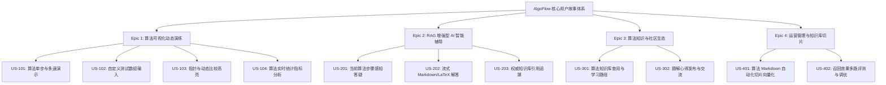

# 敏捷用户故事与验收准则 (User Stories & Acceptance Criteria)

> **文档编号**：REQ-US-001  
> **所属模块**：01. Requirement  
> **状态**：Active  
> **基准版本**：v1.0.0

---

## 1. 用户故事全景图

用户故事按核心 Epic 划分为 4 个主要业务域：

---

## 2. Epic 1: 算法可视化演练 (Visualizer)

### US-101: 算法单步与多速演示
* **作为** 一名正在准备面试或学习算法的学生，
* **我想要** 能够对所选排序算法自由执行“播放”、“暂停”、“单步前进”、“单步后退”并调节播放速率，
* **以便于** 在复杂的递归或分区步骤中暂停思考，并逐步回溯数据交换的过程。

> **验收准则 (Acceptance Criteria)**:
> 1. 点击“播放”后，柱状图/矩阵按当前设定速度（如 1.0x）平滑播放每一步演算；
> 2. 点击“暂停”后，动画与状态机在 50ms 内冻结，数值与高亮指针保持不变；
> 3. 点击“单步前进 (Step Next)”：仅推进一个微步骤（如一次比较或一次交换），指标面板计数加 1；
> 4. 点击“单步后退 (Step Prev)”：能够完美还原上一状态（包括数组顺序、指标计数、指针位置）；
> 5. 速度滑块支持 0.25x、0.5x、1.0x、2.0x、4.0x 无级调节，切换时无需重启演练。

### US-102: 自定义与特定形态数据集
* **作为** 一名算法学习者，
* **我想要** 选择典型的数据分布（近乎有序、完全逆序、大量重复元素、随机分布）或输入自定义逗号分隔数值，
* **以便于** 检验排序算法在极端情况或边界测试用例下的表现与时间复杂度退化情况。

> **验收准则 (Acceptance Criteria)**:
> 1. 提供 4 种典型预设形态的快速切换按钮；
> 2. 提供自定义数组输入框，前端校验合法性（必须为正负整数，长度限制 3~30 项）；
> 3. 非法输入（如含字母、空值或超限）时给出友好表单提示，杜绝抛错白屏；
> 4. 点击“生成/应用”后立即重置演算工作台为初始状态。

### US-103: 指针与动态比较高亮
* **作为** 算法初学者，
* **我想要** 柱状图上能以清晰不同的色彩和图标指示出“基准值 (Pivot)”、“比较中 (Comparing)”、“交换中 (Swapping)”与“已就绪 (Sorted)”，
* **以便于** 直观区分当前算法正在对哪些元素做决策。

> **验收准则 (Acceptance Criteria)**:
> 1. 比较状态采用高辨识度的琥珀黄高亮，交换状态采用醒目高亮，已就绪采用经典翡翠绿；
> 2. 柱体顶部或底部显示当前活动指针名称（例如快排的 `low`, `high`, `pivot`）；
> 3. 颜色对比度满足 WCAG 2.1 AA 规范，暗色模式与亮色模式均能清晰辨识。

---

## 3. Epic 2: RAG 增强型 AI 智能导师 (AI Mentor)

### US-201: 当前算法步骤感知答疑
* **作为** 感到困惑的学习者，
* **我想要** 在演练停留在某个复杂步骤时，直接向 AI 导师提问“为什么这里要进行这次交换？”，
* **以便于** 无需手动复制数组和行号，AI 即可精准掌握我当前的教学上下文并做出针对性解释。

> **验收准则 (Acceptance Criteria)**:
> 1. 提问请求体自动携带当前算法类型、当前 stepIndex、当前数组快照与对应的伪代码行号；
> 2. 后端 Prompt 模板将上下文精准合并，AI 回答直接针对该步骤的逻辑（如基准值选择的意图）；
> 3. 支持预置快捷提问（如“解释当前步骤”、“分析最坏情况”、“当前已排序区间是？”）。

### US-202: 流式极速生成与多格式排版
* **作为** 追求流畅体验的用户，
* **我想要** AI 的回复以流式打字机效果逐字呈现，且包含工整的公式与代码块，
* **以便于** 无需长时间等待整段生成，获得沉浸式的教学互动体验。

> **验收准则 (Acceptance Criteria)**:
> 1. 首字流式输出时间 (TTFB) ≤ 1200ms；
> 2. 文本支持标准 Markdown 语法，代码块具备语言标记与一键复制功能；
> 3. 算法时间复杂度（如 $O(n \log n)$）采用 KaTeX 规范渲染，无语法报错。

### US-203: 权威知识库引用追溯
* **作为** 严谨的学习者，
* **我想要** 看到 AI 回复引用的参考知识库章节来源，
* **以便于** 验证解答的权威性，并直接深入阅读官方教研文档。

> **验收准则 (Acceptance Criteria)**:
> 1. AI 答复底部展示召回的切片源（包含知识库文档标题、章节与相似度得分）；
> 2. 点击引用标签可平滑定位或跳转至 `docs/algorithms/` 对应的知识库文档章节。

---

## 4. Epic 3: 社区交流与个人成长 (Community & Profile)

### US-301: 算法题解与学习笔记
* **作为** 算法研究者，
* **我想要** 在平台发布我的图文题解与优化思路，
* **以便于** 与社区其他算法爱好者互动并建立个人技术影响力。

> **验收准则 (Acceptance Criteria)**:
> 1. 支持在线 Markdown 编辑器，支持实时预览与草稿保存；
> 2. 发布时可绑定算法分类标签与封面图；
> 3. 社区首页与算法页面提供题解列表展示与点赞互动。

---

## 5. Epic 4: 运营管理与知识库切片 (Admin & Ops)

### US-401: 知识库 Markdown 自动化切片与向量化
* **作为** 平台教研管理员，
* **我想要** 在管理后台上传新的算法 Markdown 文档并自动完成语义分块与向量化，
* **以便于** 知识库内容随时更新且即时被 RAG 导师检索。

> **验收准则 (Acceptance Criteria)**:
> 1. 后台基于 Flexmark AST 语法树智能按标题层级（H1/H2/H3）与 token 长度分块；
> 2. 切片后批量调用向量模型（Embedding API）存入 Elasticsearch / 向量检索库；
> 3. 管理后台提供切片预览、手动编辑与禁用开关。
