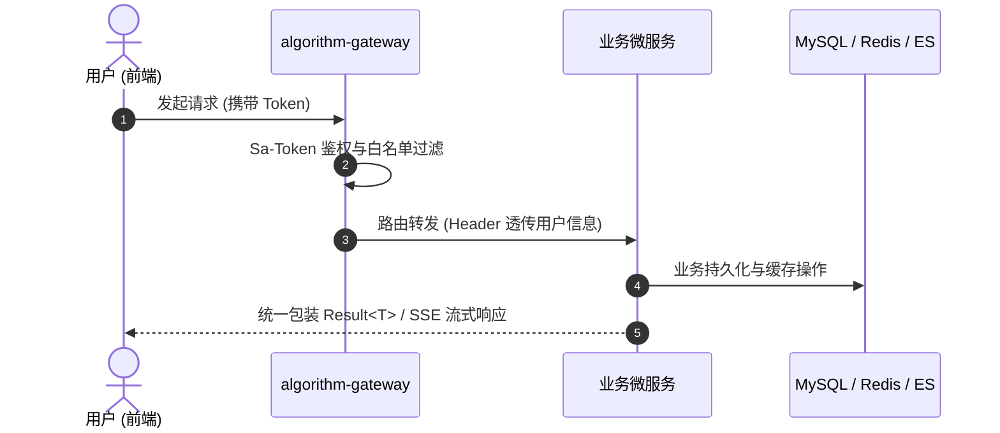

# 设计模板 (Design Specification Template)

> **文档编号**：DES-XXX-001  
> **文档状态**：草稿 / 评审中 / 评审通过 / 实施中 (注意：具体实施状态由 BACKLOG 调度)  
> **来源依据**：填写来源需求 ID（如 `REQ-SRS-001 §2.1`）、来源文件及章节；已确认规则、设计建议、待定项需明确标注区分。  
> **禁止行为**：不要复制 BACKLOG 的任务进度表，也不要用未实测的指标作无根据的性能承诺。

---

## 1. 摘要

简明扼要说明本设计所针对的核心业务/技术问题、预期产出方案与达成的最终效果。

---

## 2. 参与者与职责

列出核心使用者、业务/教研确认人、技术负责人与架构评审人（未知姓名不补造，以角色指代）。
* **业务/教研发起者**：
* **架构/设计评审人**：
* **技术实现负责人**：

---

## 3. 背景与约束

说明当前客观事实、业务来源与技术约束条件：
* **系统现状**：说明相关模块现有代码或能力现状（历史背景只查 Git 提交与真实代码，不凭空臆造）；
* **架构约束**：如后端微服务分层（Controller/Service/Mapper）、OpenFeign 契约调用、Sa-Token 鉴权、前端 Next.js 15 App Router / RSC 约束；
* **视觉与交互约束**：遵循 Apple 极简设计系统规范（`docs/design/ui-ux.md`），唯一交互色 `#0066cc`。

---

## 4. 目标与非目标

### 4.1 核心目标 (Goals)
填写可量化、可核验的技术与业务结果（如支持 19 种算法步进、支持 SSE 毫秒级流式响应）。

### 4.2 非目标 / 范围外 (Non-Goals)
明确本期设计不涉及的内容，防范需求蔓延（Scope Creep）。

---

## 5. 使用场景与触发链路

详细描述系统的关键使用场景：
* **触发条件**：用户行为（如点击单步演练、触发 RAG 提问、上传 Markdown 课件）或系统定时事件；
* **执行角色**：普通学员、进阶工程师、教研管理员；
* **前置条件**：如必须先登录、必须已选择特定算法、必须建立 WebSocket/SSE 连接。

---

## 6. 核心价值

量化说明该技术设计带来的收益：
* 减少的操作步骤与认知负担；
* 性能提升（如引入 Caffeine 本地缓存降低 Redis 集中压力 70%）；
* 架构解耦度与可维护性提升。

---

## 7. 技术方案详述 (Solution Architecture)

### 7.1 架构拓扑与交互时序


### 7.2 规则分类说明
* **已确认规则 (Confirmed Rules)**：已经各方评审敲定的业务逻辑或协议格式；
* **设计建议 (Design Recommendations)**：架构层给出的推荐做法（如选用 Caffeine 二级缓存）；
* **待定问题 (Open Questions)**：尚未达成共识的技术选型或业务分支，待后续决策。

### 7.3 关键接口与契约定义
提供规范的 OpenFeign Client 声明与 DTO / VO 结构：
```java
@FeignClient(name = "algorithm-xxx-service", path = "/api/xxx")
public interface XxxFeignClient {
    @PostMapping("/query")
    Result<XxxVO> queryInfo(@RequestBody XxxDTO dto);
}
```

### 7.4 异常处理与边界防御
* 边界输入、网络超时、并发竞态控制（Redisson 分布式锁）；
* 降级与容错兜底策略。

---

## 8. 实施与验收核对

* **实施前置与依赖**：明确前序必须完成的模块或配置；
* **正常流程验收**：按可观察现象核对预期结果；
* **异常与边界场景**：验证非法参数、断网重连、超限防御等场景；
* **证据记录方式**：执行后填写测试命令、日志与测试报告；未执行前写“未执行”。
