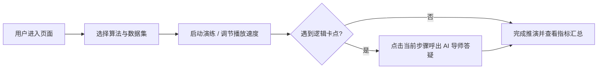

# 产品需求文档模板 (PRD Specification Template)

> **文档编号**：PRD-XXX-001  
> **所属模块**：03. PRD  
> **唯一来源设计**：链接至唯一对应的技术设计文档（如 `docs/design/architecture.md`）  
> **原则**：PRD 说明“用户需要什么、范围边界在哪里、交互规则是什么、如何验收交付”。状态统一由 [BACKLOG.md](../../BACKLOG.md) 调度。

---

## 1. 产品背景与定位

* **业务价值**：说明该功能模块为用户（学员/教师/开发者）解决的核心痛点；
* **产品定位**：属于工作台核心演算、AI 智能辅导、社区共创还是统一运营；
* **用户群体**：初学者、备考求职者、教研管理员。

---

## 2. 范围与边界 (Scope & Boundaries)

### 2.1 包含功能 (In Scope)
* 本期必须交付的核心特性清单（按优先级 P0/P1/P2 列出）。

### 2.2 明确排除 (Out of Scope)
* 本期暂不实现的边缘功能，防止过度设计。

---

## 3. 信息架构与用户流程 (IA & User Journey)

### 3.1 页面/模块信息架构
清晰定义页面层级、主次区域、操作抽屉及路由路径（Next.js 15 App Router 规范）。

### 3.2 核心用户操作旅程

---

## 4. 功能详细规格与交互规则 (Detailed Specifications)

### 4.1 核心功能清单与交互细节
按功能点详细拆解：
* **模块名称**：
* **界面原型与排版**：提供 ASCII 线框图或 UI 描述；
* **操作交互行为**：点击、悬浮、拖拽滑块时的微交互；
* **数据状态展示**：正常数据、空状态（Empty）、加载中（Loading Skeleton）与错误状态。

### 4.2 动效与视觉表现 (遵从 Apple 极简规范)
* 主交互色统一使用 `#0066cc`；
* 动效使用 GSAP 60 FPS 物理缓动，支持 `prefers-reduced-motion`；
* 无障碍指示与 ARIA 标签规范。

---

## 5. 非功能性需求 (NFR)

* **性能指标**：首屏 LCP ≤ 1.5s，交互 INP ≤ 100ms，流式首字 TTFB ≤ 1200ms；
* **兼容性**：主流现代化浏览器（Chrome、Safari、Firefox、Edge）与移动端响应式；
* **安全性**：输入 XSS 净化、防刷限流与接口越权防护。

---

## 6. 验收标准与交付清单 (Acceptance Checklist)

列出交付时必须逐项核对的条件，每项对应具体的可观察现象：
- [ ] 核心流转与正向场景验证通过；
- [ ] 异常数据与极端边界防御生效；
- [ ] 对应自动化测试用例全量通过；
- [ ] 符合 Apple 极简与无障碍规范。
